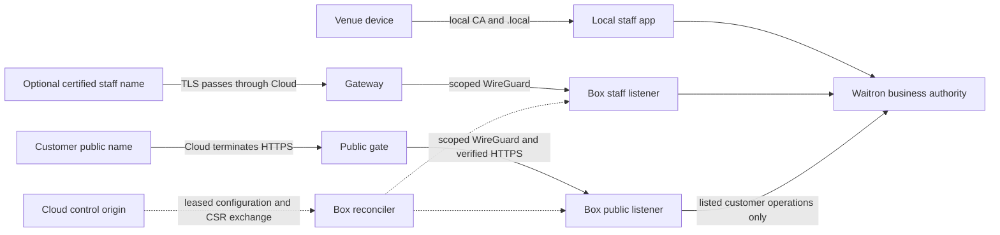

# Build authority update: 2026-10-23

The owner approved the complete A951 plan and the build of all five cuts, in their
planned order, answering “Go ahead and build.” (watcher relay about 06:45).
The earlier planning-only statements below record the previous approval state.
Bilateral contract acceptance, file reservations and provider/runtime gates still
apply. Follow the [build intake](../../developers/cloud-connection.md#a951-build-intake)
for the inspected contract pins and the affected pre-code gates. This update grants
no provider operation, deployment or customer service switch.

---

# Approval update: 2026-10-22

The owner approved the complete revised two-interface design **for preparing its
implementation plan only**, answering “Yes to both” in the watcher relay at about
17:25. The [implementation plan](../plans/2026-10-22-a951-connection.md) is now
prepared for owner review. Approval of that plan, separate build authority, pinned
bilateral scoped contracts and applicable provider/runtime qualifications remain
open. No implementation, deployment or service switches are authorised here.

The published revision and historical draft below are preserved verbatim. Their
awaiting-planning-approval wording records the earlier publication state; this dated
update supplies the current approval scope without widening it.

---

# CURRENT REVISION: A951 connection and two remote interfaces

**2026-10-22. Incorporates the owner's decision 1 correction at about 16:15 and
addendum at about 16:20. Complete revised design awaits approval for planning only.**

Your remote connection gives you reachability to the box. It does not decide which
services you find there. A951 supplies the tunnel, certificates and appropriately
segregated listeners, with a default-deny route-manifest framework. It enables no
customer product automatically and authorises no per-service publication controls.
This revision takes precedence over the historical draft below; all technical
requirements and proposals not superseded here remain part of the revised design.

## Follow the existing Cloud architecture

This applies an existing decision, rather than proposing the two-interface choice
again. At Cloud pin `35af2d396d916223ff4f319d8f44093685d62da5`:

- [Product and platform, lines 89–104](https://github.com/waitron-io/waitron-cloud/blob/35af2d396d916223ff4f319d8f44093685d62da5/docs/product-and-platform.md#L89)
  calls this the “Confirmed compromise”: public HTTPS terminates in Cloud for
  inspection; staff TLS passes through on a separate hostname. Lines 148–180 retain
  `.local` as the default and specify the separate names, keys and onward transport.
- [Public access and A951, lines 115–263](https://github.com/waitron-io/waitron-cloud/blob/35af2d396d916223ff4f319d8f44093685d62da5/docs/waitron-integration-contract.md#L115)
  remains **PROPOSED**: lines 129–149 describe the entrances, 156–209 the restricted
  customer boundary and 211–263 the lifecycle and acceptance gates. The confirmed
  architecture does not approve every detail of that contract.
- [D101, lines 43–79](https://github.com/waitron-io/waitron-cloud/blob/35af2d396d916223ff4f319d8f44093685d62da5/docs/superpowers/specs/2026-10-22-cloud-data-protection-design.md#L43)
  inventories remote transport and security metadata separately. Lines 124–128
  distinguish in-memory processing from storage and provider access; lines 341–351
  retain D101's scoped authority and remaining gates.

SHA-256 of those pinned document bytes, in the same order, checked with
`git show <pin>:<path>` and `shasum -a 256`:

| Document             | SHA-256                                                            |
| -------------------- | ------------------------------------------------------------------ |
| Product and platform | `f3ccc126d829b380d2bf31a4983406a4a15c05fc156454e8cd359ff9bbbb18ff` |
| Integration contract | `1b3b43a3d92ed83ca8816bd8867f24176a82d7ceb0c83e25a7b36440a19deaa7` |
| D101                 | `34c27c92f952b2499c140533efd9193063821348977bf8fa83003001acf459d1` |

These are source-inspection receipts, not runtime verification.

## Keep the two remote interfaces distinct

1. **Dashboard/staff hostname:** the browser's TLS connection ends at the box.
   Cloud passes the encrypted connection through, so it cannot inspect staff HTTP
   content on that forwarding path. The staff certificate's private key stays at
   the box. Cloud still sees hostname, IP and connection metadata. This is the
   confirmed architecture with proposed controls, not proof of deployment, metadata
   invisibility or protection from host-provider privileges. Network and connection
   filtering happen at Cloud; staff HTTP authentication and permissions stay at the
   box. `.local` remains the venue default. The optional remote staff origin needs
   separate authentication, device, cookie and passkey qualification; existing local
   sessions or enrolment do not automatically follow it. Public customer credentials
   must never enter staff APIs.
2. **Customer hostname:** browser TLS ends at Cloud so it can filter bots and attacks.
   Cloud holds that public certificate's private key. It forwards accepted requests
   over scoped WireGuard and verified encrypted upstream HTTPS to the box's customer
   listener. Keep the box's independent public-upstream identity, private key and
   certificate, and authenticated Cloud forwarder, separate from staff TLS. The
   proposed mutual TLS lifecycle in historical section 7 still needs joint acceptance.
   The customer listener refuses dashboard, staff login, till/device, setup, recovery,
   sync, backup/restore, fiscal administration, hardware and staff catch-all routes.
   Both boundaries deny unlisted routes; there is no wildcard public proxy.

Whether particular customer routes may also appear on the staff hostname remains a
named product/interface decision. Recommend default deny there until explicitly
agreed, without attributing that recommendation to the owner. The customer-host
refusal of staff routes does not decide the reverse direction.

## Separate inspection from retention

Cloud can see public request and response plaintext in memory for filtering,
including booking contact details and order details. Limit processing to the agreed
purpose and minimise data. This visibility grants no general right to keep payloads.
Keep raw bodies, cookies, authentication material and QR/session secrets out of
shared diagnostics and shared private-state caches. Retain historical sections 8
and 10's payload exclusions and private-status `no-store` requirement.

The allowed metadata fields, purpose, access, location, bounds and retention policy
remain an **A980/D101 joint acceptance gate** for the affected flow, including staff
transport metadata. No retention period or provider authority is invented here.
The [contract's lines 197–203](https://github.com/waitron-io/waitron-cloud/blob/35af2d396d916223ff4f319d8f44093685d62da5/docs/waitron-integration-contract.md#L197)
and D101's register requirements above supply the existing boundary, not a claim
that encryption means no processing or that these controls are deployed.

## What matches, and what this correction supersedes

The following references use the unchanged historical draft at Waitron publication
`497489340977a4ccb3f3e98609c6d4b47cdb8c69`, so prepending this revision cannot move
their cited line numbers:

- **Already matches:** [section 3, lines 73–132](https://github.com/clintongormley/waitron/blob/497489340977a4ccb3f3e98609c6d4b47cdb8c69/docs/superpowers/specs/2026-10-22-a951-box-public-access-design.md#L73),
  including the diagram at 80–93, separates local access, staff passthrough and public
  termination. [Section 7, lines 288–317](https://github.com/clintongormley/waitron/blob/497489340977a4ccb3f3e98609c6d4b47cdb8c69/docs/superpowers/specs/2026-10-22-a951-box-public-access-design.md#L288)
  separates certificate purposes and failure scopes. [Section 8, lines 432–478](https://github.com/clintongormley/waitron/blob/497489340977a4ccb3f3e98609c6d4b47cdb8c69/docs/superpowers/specs/2026-10-22-a951-box-public-access-design.md#L432)
  supplies default deny, credential separation and no offsite queue.
- **Superseded:** [section 13, lines 644–677](https://github.com/clintongormley/waitron/blob/497489340977a4ccb3f3e98609c6d4b47cdb8c69/docs/superpowers/specs/2026-10-22-a951-box-public-access-design.md#L644)
  misplaced publication-per-service as A951's first decision. Its question and
  recommendation of independent controls are withdrawn from A951. Every implication
  that publication, pause or service switches belong to the connection's lifecycle
  is superseded, wherever it appears in the historical draft.
- **Scope corrected:** [section 10, lines 515–528](https://github.com/clintongormley/waitron/blob/497489340977a4ccb3f3e98609c6d4b47cdb8c69/docs/superpowers/specs/2026-10-22-a951-box-public-access-design.md#L515)
  lists “Public products”; that is separate product readiness, not connection
  lifecycle or authority to switch services. [Section 8, lines 410–489](https://github.com/clintongormley/waitron/blob/497489340977a4ccb3f3e98609c6d4b47cdb8c69/docs/superpowers/specs/2026-10-22-a951-box-public-access-design.md#L410)
  and [section 11, lines 540–591](https://github.com/clintongormley/waitron/blob/497489340977a4ccb3f3e98609c6d4b47cdb8c69/docs/superpowers/specs/2026-10-22-a951-box-public-access-design.md#L540)
  retain the manifest framework and path-scoped acceptance. Customer publication,
  pause, authentication, privacy and business choices belong to separate product
  designs, not automatic A951 controls.

## Retain the technical boundaries and scoped gates

- Keep all three independent counters: installation configuration revision, appliance
  content revision and transport-grant sequence. Preserve durable apply/acknowledgement,
  stop/reboot recovery, scoped network rules, cell moves, fresh replacement secrets
  and exclusion of endpoint secrets from transferable state.
- Keep staff CSR v1 opt-in and test-installation-only. Preserve its exact exchange,
  current-intent checks and atomic install/reload. Neither the install helper nor
  this revision permits an arbitrary issuer. Public-upstream mutual TLS needs its
  own accepted issuer/trust and renewal/revocation lifecycle; it cannot
  silently widen staff v1.
- Fail closed on expiry/revocation for the affected remote path and its connections;
  shared transport withdrawal closes both remote paths. Unrelated `.local` sales
  remain governed locally. No WAN/Cloud dependency is added to local sales, no
  offsite booking/order queue is introduced, and lost outcomes require reconciliation.
- Tunnel access, certificates and control leases confer no writer, restore or fiscal
  authority. Preserve the already answered D88 cold-recovery choice rather than a
  running follower, and the `.local` and soon-after-go-live
  decisions. No fiscal clock or identity rule changes. Storage and migration choices
  wait for the approved plan. Historical timer values, including the ten-minute
  transport grant, one-minute attempts, 30-second drain and 5-second to 5-minute CSR
  polling proposal, remain proposals requiring scoped agreement, not owner decisions.

The foundation must not wait for customer pages or their product policies. After
the relevant approvals, qualify segregated listeners with an empty customer manifest
and isolated test fixtures. Staff-only qualification can proceed separately with its
own origin/device approvals; customer-path qualification needs its independent
upstream identity and privacy contract. Apply each acceptance case only to the path
or capability being enabled, while checking that other routes remain denied.

Full owner approval of this revised connection design, bilateral pinned scoped
contracts, an approved implementation plan, separate build authority and applicable
provider/runtime qualifications remain open. D101 planning approval does not supply
them. This revision is documentation only. Customer pages remain separate designs.

## One owner question: approve the revised connection design for planning only

Your tills stay on `.local`. Away from the venue, you reach the dashboard through
the encrypted staff hostname. A customer's booking request is inspected at Cloud
and forwarded through the separate customer path; the booking product controls
whether bookings are available. The tunnel supplies access, without switching the
booking service on.

**Do you approve the complete revised A951 connection design for preparing its
implementation plan only? Recommendation: yes.** A yes authorises writing the plan;
it approves no unwritten plan, runtime build, deployment, provider work or service
switches. Later technical contracts and per-product privacy, authentication and
pause choices remain separate. It does not reopen the two-interface decision.

---

# Historical draft: preserved verbatim; the current revision above takes precedence

# A951: Keep the box connected without opening its staff interface to customers

**22 October 2026. Proposed box-side design for owner review. No implementation plan,
product changes, deployment or provider work is authorised by this draft.**

You should be able to keep your tills on the venue's local network and still let a
customer book, order or read your menu from their own phone. The box remains the
place that accepts the business operation. Cloud supplies a public entrance and the
connection to it. Losing that entrance must not add a Cloud dependency to local sales.

A951 designs that connection's whole lifetime, including a reboot, a renewed
certificate, a moved gateway and a replaced box. Customer pages remain separate
product designs. The controls below are **future requirements and author proposals**,
unless explicitly identified as an existing decision or inspected implementation.
They are not runtime verification or a claim that the proposed boundary is already secure.

## 1. Keep the decisions and approval gates distinct

The Lane F A951 queue records the owner's choices: venue devices use `.local` by
default; a certified staff hostname is optional; customers use the separate public
interface through WireGuard. This comes with Cloud soon after go-live. On 22 October
the owner raised the design to next after A1014 because it unblocks customer work.
There is no question here about replacing `.local`, moving this into go-live, or
making personal phones trust the venue's local certificate authority.

The joint home is Cloud's **Public access and A951 (PROPOSED)** contract, lines
115–263 [C2]. Its publication has not supplied bilateral acceptance. D88's broader
hosting, isolation and shared contracts remain proposed [C1]. Its cold recovery
choice is answered: start and restore Cloud capacity when needed. A running Cloud
follower is a separate, unapproved future option. A951 does not reopen that choice.

D101's data-protection engineering design was approved for planning, with legal,
provider and runtime gates still open. The inspected D101 document additionally
records separate authority for its first outbound-AI refusal slice only; neither
that exception nor planning approval authorises A951, hosting or runtime deployment
[C3, lines 3–21 and 341–351]. Carry its location, support and data-minimisation
boundaries into the joint contract rather than deciding them again here.

D88 refers to an older A947 revision. At the Waitron revision inspected here, A947's
second revision is owner-approved, amended on 22 October, and its header says its
work is unbuilt [W1]. It specifies five-symbol minute names and clock checks, rather
than the earlier hour description. Its section 10 still describes a running Cloud
follower; that is not approval to reverse D88's later cold-recovery choice. Before
agreement, reconcile those documents at their actual landing pins. **A947 and Waitron
own promotion, fencing, fiscal naming, clocks, installation identity, chain creation
and old-node return.** A951 consumes an explicit current authority result; it neither
chooses a writer nor treats a tunnel, certificate or Cloud lease as that result.

There are three separate gates after this draft: full owner design approval;
bilateral acceptance of one pinned contract; then an approved implementation plan
and its implementation/qualification authority. A951's build takes the FULL review
path. No implementation plan is supplied now. The migration decision belongs in that
later approved plan, after the local-state design is reconciled with A947.

## 2. What the inspected source supplies today

Both repositories were inspected as source, not run. Waitron is pinned to
`6eb2c4eb0bbefc0753f84346b05a4a55ef9b4493`; Cloud is pinned to
`35af2d396d916223ff4f319d8f44093685d62da5`. Section 12 gives exact paths and line ranges.

| Inspected piece                                  | What can be reused                                                                                                                                                                                                                             | Boundary still to design/build                                                                                                                                                                                                                                        |
| ------------------------------------------------ | ---------------------------------------------------------------------------------------------------------------------------------------------------------------------------------------------------------------------------------------------- | --------------------------------------------------------------------------------------------------------------------------------------------------------------------------------------------------------------------------------------------------------------------- |
| Cloud connection and installation client [W2–W3] | A private, atomically saved connection file; signed machine requests; persisted pending operations; lease renewal, configuration, reports and revocation. Configuration replies reject decreasing revisions and foreign registration bindings. | Service configuration is a bounded generic object, not a typed appliance network protocol. Saving it is not applying networking. The projected installation state `active` is a control-lease status, not writer authority.                                           |
| Refresh worker and boot [W4]                     | The worker calls refresh while `cloudPrimary` permits it, sleeps 60 seconds and reports errors. Boot mounts availability before mode-specific catch-alls.                                                                                      | No lasting CSR-submit/status/apply lifecycle is supplied by that worker. No fresh authority proof for a future A947 target is established by this inspection.                                                                                                         |
| Public availability [W5, C4]                     | The box returns `{"available":true}` with 200 or `false` with 503 and `no-store`. Cloud's gate forwards only `GET /public/availability`; its `/_cloud/*` challenge handlers are local to Cloud.                                                | This is not a menu, booking, customer session, order or checkout API. The box route is mounted on the shared app, not a segregated customer listener.                                                                                                                 |
| Certificate command and helpers [W6]             | `csr` creates/reuses the endpoint's RSA key and produces one-host CSR. `install` checks hostname, dates and key matching, then syncs and renames the chain file.                                                                               | The install helper does not authenticate an arbitrary issuer. It has no operation-currentness check, automatic polling or installed/reloaded acknowledgement. Replacing a key and chain together is additional work.                                                  |
| TLS watcher [W7]                                 | The listener watches configured key/chain files, validates changed material and calls `setSecureContext` for future handshakes.                                                                                                                | An unchanged accepted fingerprint returns before another date check. This is not continuing expiry enforcement, session termination, or a durable reload receipt. One trading TLS choice does not supply three listener identities.                                   |
| Existing tunnel [W8]                             | The configured `@waitron/tunnel` client opens TCP relay connections and splices to a local port.                                                                                                                                               | It is not the WireGuard appliance client. Its retirement needs a consumer audit in the later plan; A951 must not silently leave it as a second public entrance.                                                                                                       |
| Replacement and archive paths [W9–W10]           | Test replacement persists fresh installation and peer keys, binds the restored request and imports completed registration. Managed restore drops the captured backup destination.                                                              | Installing tunnel/certificate remains separate. Boot excludes production replacement. Endpoint Cloud keys and staff files are outside the current host-state archive lists; future A951 files need the same explicit exclusion audit, including module contributions. |
| Cloud gateway and CSR backend [C5–C7]            | Gateway configuration separates staff passthrough from public TLS termination and generates peer `/32` routes. CSR v1 provides predecessor-bound submission/status.                                                                            | A gateway manifest has audience `waitron-cloud-gateway`; its signed cell sequence is not a box configuration exchange. CSR v1 is opt-in and test-installation-only, not production enablement.                                                                        |
| Device cookies [W11]                             | Existing device authentication remains the staff/device boundary to trace.                                                                                                                                                                     | `cookieDomainFor` can set a parent-domain cookie. Host-only separation is a proposed requirement here, not an already implemented property.                                                                                                                           |

## 3. Three entrances with three purposes

Keep the local entrance available independently of A951's control worker. Give the
optional staff and customer paths separate listener contexts, routing rules and
credentials. A **listener** is the server socket that first receives a connection;
an **origin** is the scheme, hostname and port a browser treats as one site.

This is a proposed technical boundary, not a customer-page mock-up or a deployed topology.

The local app keeps its own local CA and leaf. It must neither redirect to Cloud nor
wait for a lease, public DNS or a staff certificate at boot or on a request. An A951
error must leave the existing Waitron local-role checks in charge. This requirement
does not promise that A951 repairs an unrelated local boot, disk or fiscal failure.

Staff TLS passes through Cloud and ends at the box using a chain for the assigned
staff hostname. The box retains staff login, permissions, device profiles and
origin checks. The proposed staff path passes TLS through without decoding HTTP
[C5], so method/path checks belong at the box. The staff endpoint must reject
unknown SNI and Host values and their disagreement.
**SNI** is the server name sent during the TLS handshake. A router override for the
certified staff name is optional and needs its own device qualification. There is no
automatic fallback from that remote name to a different writer.

The customer hostname ends TLS at Cloud. Cloud forwards only jointly listed
customer requests to a dedicated public app on a tunnel-only address/port, using
verified HTTPS and an authenticated gateway identity. The proposed onward identity
is distinct from the staff browser identity and has its own key, certificate and
renewal state. Section 7 proposes its lifecycle; its wire format and issuer still
need joint acceptance. Today's availability gate uses the staff upstream hostname [C4,
line 52]; that existing proof is not the final segregated app boundary.

The box public app must not mount staff login, till/device APIs, management/setup,
recovery, sync, fiscal administration, hardware or a staff SPA catch-all. A Host
header alone must not select the public or staff trust domain on a shared unrestricted
socket. Firewall destination rules and the app's request checks must both enforce
the chosen context. Rules must refuse attempts to reach the public listener through
the LAN, a direct WAN address or another venue's peer. Prove each boundary
independently later.

An optional staff address is a different origin from `.local`. Do not promise that
a passkey, login session or device enrolment automatically follows it. Reconcile
staff authentication and A947's device-routing contract before offering that path;
keep cookies host-only, with separate names and no parent-domain scope. Trace cookie
creation, clearing, validation, till rerouting, CORS and passkey origins together in
the plan. Do not change those consumers as part of this draft.

## 4. Receive, apply and acknowledge one durable intent

A951 needs an appliance configuration contract alongside the existing installation
exchange. The field names below are conceptual, not agreed JSON or new endpoint names.
The existing gateway manifest and generic service object must not be repurposed by
assumption [C2, lines 211–244; C5].

A candidate must bind protocol version/capabilities, Cloud origin, environment,
Cloud venue and installation, local venue/node mapping, installation key identity,
configuration revision and content digest, cell/placement epoch, active target reference,
peer public identities, tunnel addresses, explicit destination ports, staff/public
hostnames and route-manifest version/digest. A separate transport grant carries
validity times and expiry, as described below. A move adds
its operation id, predecessor and phase. Unknown mandatory fields or versions,
foreign bindings, stale revisions and conflicting configuration content for the same
revision must be refused before side effects. Pin canonical bytes, authenticated delivery and any
signature/trust-key rotation in the joint contract.

Use the configured HTTPS control origin and the existing leased machine identity.
Do not accept a replacement origin, shell text, provider key, filesystem path or
root command from a configuration reply. The existing machine envelope signs the
origin, action, installation, operation id, time, lease and body [W3]. A951's additional
actions must receive explicit contract acceptance rather than inventing signed names
locally. Share lease renewal with existing consumers without holding the connection
file lock or a database transaction across certificate issuance or network apply.

The existing control lease is at most one hour and refresh begins within its last
ten minutes [W3]. It authorises control calls. It is not the network configuration's
expiry or a writer lease. **Propose** expiring appliance transport authority no longer
than ten minutes, with refresh attempts every minute while healthy, bounded by the
Cloud gateway's separately enforced authority. Both sides must agree these numbers,
clock handling and active-connection deadlines before implementation. Separate the
stable configuration content from its renewable transport grant. A fresh authenticated
grant must bind this installation, configuration digest/revision and placement epoch,
with its own increasing grant sequence and expiry. Renewing that grant must not
change the configuration revision, restart apply or invalidate a pending CSR. A
changed configuration requires a new content revision; a replayed grant cannot extend
a deadline. Pin this distinction in the new appliance protocol. Neither an old
control lease nor a still-valid certificate may extend transport authority.

Keep three counters distinct in the proposed contract: the existing installation
configuration revision used by staff CSR v1; the new appliance configuration content
revision; and the renewable grant sequence. A transport refresh must advance only
the grant sequence, leaving both content revisions stable. A semantic installation
configuration change still invalidates v1 work under Cloud's existing checks. A new
appliance revision invalidates a pending certificate intent only when its relevant
identity, hostname, key, purpose or authority binding changes. The joint contract
must define that mapping without changing the meaning of v1's `revision` field.

Persist the accepted configuration revision and grant sequence (the high-water marks
below which older authority is refused), complete candidate bytes/digest, active
revision, operation identities, key references, local stop marker and observed phase
in node-local state outside transferable venue data. Retain only bounded predecessor
state needed for recovery. Use private files/directories and durable file/directory
sync, or an approved transactional node-local store. The exact storage and migration
choice stays open to the plan; this does not select a new table now.

| Durable phase           | Required meaning and next action                                                                                                                                        |
| ----------------------- | ----------------------------------------------------------------------------------------------------------------------------------------------------------------------- |
| Received                | Authenticated and validated, then durably saved. Report receipt without claiming the kernel, TLS or app has changed.                                                    |
| Applying                | Persist intent before each outside effect. Install candidate peer, scoped firewall and listener configuration through fixed local operations; read back actual results. |
| Applied                 | Record exactly which revision/digest, peer and listener/certificate fingerprints were observed. Keep reachability and active authority separate.                        |
| Failed                  | Retain a bounded error category and last usable revision. Do not mark an unapplied candidate successful or extend an older revision's expiry.                           |
| Acknowledgement pending | Persist the report before sending it. Retry the same report identity/bytes after reply loss; reconcile Cloud's recorded revision before generating more work.           |
| Stopped or expired      | Close remote admission and connections; keep a durable stop/expiry result. Require current authenticated authority to reconnect.                                        |

On reboot, recover the stop marker first. Validate the cache against this installation,
its configuration and grant high-water marks and current time before touching
networking. Inspect actual peer, firewall, selected key/chain and loaded listener
state; resume the saved phase,
not a second operation. Do not restore remote access from an expired or corrupt cache.
A missing established cache needs authenticated recovery with an agreed new epoch;
it must not reset rollback protection to zero. Persist a known stop independently
of a replaceable registration cache.

Use wall-clock expiry plus an elapsed-time deadline that a backwards clock jump cannot
extend. If time cannot be established after reboot, leave remote access closed until
current authority is recovered; local access still follows Waitron's own rules. Do
not alter the fiscal clock or minute-selection policy to make remote access work.

## 5. Limit the network configuration and retire authority explicitly

Generate WireGuard private keys at the box; send only public keys. Store them apart
from the machine signing key, staff TLS key, local CA and recovery archive. The
privileged helper must accept a small, versioned set of typed operations with fixed
arguments: prepare peer, apply scoped rules, inspect, activate and remove. It must
reject arbitrary commands, scripts, `PostUp`/`PostDown` hooks, includes and paths.
Cloud subscription or support permission must not grant a shell through this helper.

The future rules must scope the gateway peer to the assigned tunnel destination(s)
and the box to its own assigned `/32`. Permit only agreed staff/public upstream ports
and separate control probes. Refuse default routes, LAN routes, peer-to-peer and
cross-venue forwarding, raw printer/drawer/payment-terminal ports and unlisted
management ports. Pin IPv4/IPv6 treatment and source-address validation. A handshake
alone must not open a listener, mark it healthy or publish a route.

Prepare candidate rules before admitting traffic. Do not overwrite the venue's LAN
routing, local CA, default route or unrelated firewall rules. On partial apply, retain
the old revision only while it is still authorised and the read-back confirms its
rules; otherwise close remote access. An unsupported host/helper must give a bounded
configuration failure, not fall back to the old TCP relay or expose a WAN port.

On local disconnect, first persist a stop that survives registration/replacement-cache
loss, close remote listeners/admission and established remote connections, then send
revocation. An offline request remains locally stopped while Cloud revocation is
pending. Cloud and box must report requested versus actually enforced removal
separately. The unreadable replacement-file stop gap is already recorded [W9,
lines 387–401; backlog detail]; the proposed durable stop supersedes that weakness
only after a later implementation proves it.

On learned revocation, stop new work, reject late results and remove the peer/routes
under their own scope. During a partition, expiry supplies the agreed upper bound;
this draft promises no instantaneous remote revocation. At expiry, close existing
connections as well as new admission. A mutation accepted before closure may have
committed: retain its outcome for authenticated reconciliation, without extending the
revoked credential. Closing a socket must not roll back a ledger or repeat a payment.
Cloud disconnection alone does not change Waitron's local writer/fiscal authority.

## 6. Move a connection between cells without moving the writer

A **cell** is a bounded Cloud gateway/operational group. An A951 cell move changes
transport placement for the same active Waitron endpoint. It is not a database move,
restore, promotion or upgrade. If the active endpoint must change, hand off to D88 and
A947 and wait for their explicit result before routing.

Record one move operation, expected old placement and new candidate revision on both
sides. Serialize it with disconnect, key rotation, replacement and competing moves.
Propose these phases:

1. **Prepare.** Keep the old path while authorised. Generate/stage a distinct candidate
   peer if required; the new cell may probe only. Do not route customer or staff
   requests there yet. Persist candidate identity, expiry and predecessor.
2. **Check.** Verify destination scope, actual TLS identity, both hostname mappings,
   compatible route manifest and the same current Waitron authority. DNS/certificate
   provisioning or a tunnel handshake alone cannot commit a move.
3. **Commit.** Cloud records the new placement with a conditional predecessor check.
   Stop new admission on the old gateway, drain existing remote connections for a
   proposed maximum of 30 seconds, then close them. Confirm withdrawal or wait for
   the old authority's expiry before publishing new admission. A brief unavailable
   interval is preferable to an untracked old entrance. Pin this handover contract
   and bounds jointly; it is not supplied by today's manifest.
4. **Retire.** The box removes the old peer/rules after confirmation. Both sides retain
   the bounded move receipt and stop accepting the old epoch. Probe the new path and
   acknowledge actual applied state.

Before commit, cancellation removes only the staged candidate and returns to the
still-authorised old configuration. If it has expired or been revoked, cancellation
leaves remote access unavailable. After a lost commit reply, query the operation and
both gateway placements; do not infer cancellation or resubmit a new move. After
commit, a reversal needs a new increasing revision and a new move. It cannot replay
the predecessor or extend its expiry. After possible business effects on a changed
endpoint, preserve state and reconcile through A947/D88; never roll back a database,
activation or fiscal identity to recover a network move.

## 7. Reuse the exact staff CSR v1 exchange

A **CSR** is a certificate request containing the endpoint's public key and requested
name. Its private key remains at the endpoint. Keep four certificate contexts
separate: the local CA/leaf, the box's certified staff chain, the box's public-upstream
identity and Cloud's browser-facing public certificate. Cloud retains that last
certificate's issuance and renewal [C2, lines 143–147]. The existing v1 exchange
supplies only the staff chain; it supplies no public-upstream identity.

**Propose independent public-upstream TLS**, with a box-generated key and a Cloud
issuer scoped to the public transport purpose. The gateway authenticates that box
identity, and the box authenticates a separately scoped gateway client identity.
The accepted identity must bind installation, venue, endpoint, purpose and current
appliance configuration. This is a proposed mutual TLS contract, where both ends
check a certificate, not an existing feature or a decision about its issuer technology.
Its submit/status, renewal, revocation and issuer-rotation format needs a new joint
agreement. Do not send this CSR through staff v1 or quietly widen its hostname or
test-only rules. Without that accepted exchange and its runtime proof, keep the
public upstream path closed; base transport work can still use isolated test identities.

The public-upstream client must persist its own request and current-intent bindings,
retry/status state, key/chain generations and reload receipt. Apply the same durability,
late-result refusal, pair selection, expiry and crash-recovery requirements described
below, with that exchange's separately accepted messages and limits. Rotate gateway
trust with an explicitly bounded overlap; an expired or revoked gateway identity
cannot continue using established connections. A public-upstream failure closes only
the public path. Missing, disabled or expired staff TLS closes only the optional
staff path. Neither may prevent the other listener or local TLS from starting.
Shared transport expiry, local disconnect or installation revocation closes both
remote paths. Prove these independent failure scopes before enabling either path.

CSR v1 is the landed contract at [C6], lines 425–511. The Cloud account server enables
it only with `CLOUD_STAFF_CERTIFICATES=1` and an installation issuer; the backend
refuses production installations [C7]. Retain those restrictions in the first client
and joint proof. Production support requires separately approved Cloud changes and
qualification. This design must not turn a production refusal into an automatic retry
or switch environments to get a certificate.

Use POST `/api/installations/staff-certificate-submit` and
`/api/installations/staff-certificate-status`, with the exact final path segment as
the signed action in `waitron-cloud-machine-v1`. Both require a current control
lease, fresh proof time and no browser Origin. Keep the existing 60-second proof
window, one-hour maximum lease, 4096-character signed-body bound and account request/rate
limits. Do not enlarge them to fit a malformed request [C6, lines 427–436, 489–495].

For submit, persist a fresh UUID and the **exact JSON body bytes** with these fields:
`version: 1`, current `hostname`, current configuration `revision`, `csr` PEM and
`previousRequestId`. The first predecessor is null; each later submission names the
request it replaces. A retry after a lost reply signs the same operation id/body
with a fresh timestamp and live lease. It may already return the completed chain.
A new intended request always receives a new UUID.

Cloud keeps one current request row per installation. Only one predecessor-bound
replacement wins. Same current id with changed input, a foreign current id, a stale
predecessor or a superseded status id conflicts with HTTP 409. **There is no historical
id ledger**: deliberately reusing a superseded id with the current predecessor would
be new work. The box must never exploit that or assume a superseded retry can recover
old work [C6, lines 459–468]. Keep the current remote request id separately from the
last installed certificate's request id; they can differ during renewal.

Status signs exactly `{"version":1,"requestId":"<submission UUID>"}` with a **fresh
envelope operation id**. Submit/status return `version`, `installationId`, `requestId`,
`hostname`, `revision`, `csrDigest`, `state` (`pending` or `ready`) and `certificate`
only when ready. The digest is SHA-256 of submitted CSR PEM bytes, not the submit-body
digest. Pending includes waiting, retrying and work parked after eight reconciler
failures. Do not invent a public `failed` state or assume pending means the worker is
running [C6, lines 470–495; C7].

Propose the following box lifecycle around that unchanged exchange:

- Persist intent before CSR submission: installation/key identity, local generation,
  assigned hostname/revision, exact CSR bytes/digest, key reference, predecessor,
  submit UUID/body, phase, attempt count and next action time. Use the existing helper's
  validation; never upload the key or a path.
- Before submit, each poll and installation, re-read current local intent. Stop/re-pair,
  replacement, the existing installation configuration revision, hostname or key
  changes invalidate the old result. A mere transport-grant renewal does not change
  that revision or invalidate the request. For an appliance-content change, use the
  explicit certificate-binding mapping in section 4. Check again under the same short local apply lock immediately before
  switching files, so an in-flight reply cannot undo a newer stop or key choice.
- On 401, reconcile/renew the lease once and retry the same intent only if still
  current. A body-size failure remains a request failure. On 403, stop issuance and
  distinguish known revocation from unsupported production/service authority through
  bounded status; never loosen authentication. On 409, refresh configuration and
  reconcile the saved predecessor/current request. Do not loop by making UUIDs or
  guessing a predecessor; v1 has no general historical-request lookup.
- For pending and transient network/5xx responses, propose a randomised exponential
  polling delay, at least 5 seconds and capped at 5 minutes, with a per-request deadline and
  bounded response bytes. Persist attempt/next-time across reboot. Keep retrying at
  the capped rate while authorised; surface prolonged pending to the operator rather
  than reset the request. Respect a valid bounded server retry hint. Final values and
  a response cap compatible with v1 need joint acceptance.
- Before install, compare every returned binding with the still-current intent:
  installation id, request id, exact hostname, revision and CSR digest, plus version,
  ready-state shape and local key identity. Obtain the chain only through the pinned
  trusted Cloud HTTPS origin with redirects refused. Validate chain, dates, hostname
  and private-key match through the existing install helper. It does not establish
  arbitrary issuer trust by itself [W6; C6, lines 497–504].
- Stage a complete key/chain generation, meaning one version of the pair, in private
  local storage, sync it and switch one durable active-generation reference. Reusing a key still uses atomic chain
  replacement. Rotation must not expose an old chain with a new key between writes.
  The plan must adapt the helper/listener boundary for that pair selection; today's
  helper only atomically replaces the chain. Retain the old generation until reload
  succeeds, but only serve it while name, dates and transport authority still permit.
- Reload the correct remote listener and record the observed loaded fingerprint after
  a real new handshake. A file rename or successful Cloud issuance is not a reload
  receipt. A crash after rename resumes inspection/reload; a crash after reload but
  before acknowledgement recovers that fingerprint and reports the same outcome.
  Boot validates the selected generation before opening remote admission.
- Schedule renewal before the installed chain enters Cloud's renewal window, with
  enough margin for retries; use a new predecessor-bound request and current revision.
  Cloud's inspected window is the smaller of 30 days and one third of certificate
  lifetime [C8]. Agree lead margin/jitter and key-rotation cadence jointly. Preserve
  an authorised usable chain during failure; never change local CA trust for renewal.
  At staff-chain expiry/mismatch, close the staff listener's admission and existing
  staff connections; the public-upstream and local contexts remain independent. Add an
  independent expiry deadline: today's watcher is not that guard [W7].

No polling or install operation belongs on the local sale path. Certificate failure
must change remote readiness and a bounded diagnostic, not prevent local listener
startup or make a sale call Cloud.

## 8. Expose customer functions only after their products agree a manifest

The following names describe intended functions, not paths or permission to expose
existing staff endpoints. Each customer's product design must settle its own state
changes, assets, authentication, operation/status format and refusal wording before
its rows enter the joint route manifest [C2, lines 156–209].

| Product         | Intended public family                                                              | Separate design/mock-ups still required                                                                                                                                                    |
| --------------- | ----------------------------------------------------------------------------------- | ------------------------------------------------------------------------------------------------------------------------------------------------------------------------------------------ |
| Published menu  | Listed GET resources; HEAD only if individually accepted                            | Customer menu, language choice, published images, venue information and privacy link. No internal catalogue or staff preview.                                                              |
| A1013 bookings  | Availability, scoped session bootstrap, create and own-booking/status/change/cancel | Time/party selection, contact details, confirmation, reminders and unavailable/uncertain outcomes. No booking while the box cannot be reached.                                             |
| A508 table QR   | Table-scoped menu, order, call waiter, ask for bill and intended checkout           | Entry from the printed QR, table/session expiry, copied link, new seating, order and payment recovery. A QR confers no staff role, bill ownership, payment authority or proof of presence. |
| A509 collection | Own basket/order, submission, checkout and status                                   | Collection options, current prices/availability, confirmation and uncertain payment/order recovery.                                                                                        |
| A1012 delivery  | A509's later delivery family                                                        | Address, delivery eligibility and handling, personal-data and provider contracts. It follows collection.                                                                                   |

A951 draws none of those pages. It also does not choose customer retention periods,
bot-challenge product policy, or a payment provider. Customer checkout is intended;
physical terminal-port exclusion does not exclude it. Provider redirects/webhooks
need separate authenticated routes, replay handling and acceptance. Do not open a
wildcard webhook or let Cloud price, settle a payment, issue an invoice, file a record
or decide fiscal authority.

The jointly versioned manifest must enumerate exact paths/templates and variable
constraints, methods, query rules, assets, content types, request/decoded-response
sizes, deadlines, authentication/session requirements, caching, operation/status
semantics and enabled-product revision. No `/api`, `/public/*`, media-tree or static
asset wildcard, fallback proxy, method override or unlisted upgrade. GET must not
perform business writes. An asset is admitted because a published customer page
requires those bytes, not because it shares a directory with staff assets.

Default deny at **both** gateway and box. Define one normalization/refusal algorithm
and shared adversarial vectors: malformed escapes, encoded separators, double
encoding, dot segments, backslashes, duplicate routing headers, absolute-form URLs,
trailing slash and duplicate/query ambiguities. Reject ambiguity before routing;
do not let one parser decode into a route the other refused. Pin host spelling/ports,
Host versus `:authority`, SNI and forwarded public-origin binding. A public name must
never select a staff handler, even when the correct staff credential is supplied.

Trust forwarding metadata only from the authenticated, allowlisted gateway over its
intended tunnel listener. Strip caller-supplied `Forwarded`, `X-Forwarded-*`, routing,
client-IP, venue and authentication assertions at the gateway and overwrite only the
accepted context. The box verifies that context and its peer/venue/revision binding;
it never trusts an arbitrary forwarded tenant id. Upstream TLS SNI may name the
separate upstream identity while verified forwarding binds the original public host;
the joint contract must specify this mapping, not compare unrelated names blindly.
Direct requests carrying the same headers must fail. For routes requiring customer
authority, the gateway must validate the jointly agreed customer session/token
envelope before forwarding. Waitron must independently revalidate that authority and
its current business scope; a trusted gateway assertion alone is insufficient.

Use distinct host-only public session, staff/device and Cloud challenge cookies with
Secure/HttpOnly and the product's agreed SameSite policy. No shared Domain scope or
credential forwarding. Refuse staff/device/machine credentials on the public app and
public credentials on staff APIs; do not silently reinterpret them. The gateway's
current `__Host-waitron-public` is a bot-challenge cookie, not customer authentication
[C4, lines 43–47]. Agree a distinct customer-session name rather than reuse it.

For cookie-authenticated mutations, check the exact public Origin and anti-CSRF
proof. These controls must refuse another site submitting through the customer's browser.
Refuse unaccepted CORS origins and Origin-less browser mutations. For scoped
capabilities, bind venue, public host, customer/session, object, purpose, expiry and
revocation; prove their replay rules separately. Gateway challenge success must never
supply business permission. Keep cookies, token/QR secrets, bodies and personal data
out of gateway diagnostics and shared caches. Private status uses `no-store`; public
menu caching, if later approved, needs explicit publication/venue keys and invalidation.

Serialize public business writes with staff work through Waitron's one authoritative
writer. Recheck prices, availability, ownership and state at commit. No offsite queue:
an unreachable box never causes Cloud to accept a booking or order for later delivery.
A timeout after forwarding means **unknown**, not a rejection or a new submission.

Every future mutation needs a durable venue/session-bound operation id and input
fingerprint, recorded with its business outcome. Same id/same input must reconcile the
same result; changed input must conflict. Own-status access must not reveal another
customer's operation or permit enumeration. After reply loss, look up that operation
before retrying; unresolved status means keep it pending and do not repeat payment.
A provable absent result may allow retry of the same id only under the product's
agreed transaction/retention rules. Neither a gateway timeout nor an expired retained
result is evidence of absence. Exact bytes, endpoints, retention/replay horizon and
reconciliation across A947 promotion remain joint/product gates, not invented APIs here.

## 9. Replace endpoint secrets without importing old access

The inspected test replacement already creates fresh machine and WireGuard peer
keys and imports completed registration; managed recovery has staged/restored/reported
phases [W9]. A951 must attach to that durable result rather than create another Cloud
venue or treat `complete` as permission to trade. Restore and fiscal preparation stay
with Waitron's existing recovery/A947 contracts. Production replacement remains gated.

After authenticated replacement and Waitron's accepted authority result, obtain the
replacement's own configuration, apply its fresh peer, request a chain for its own
staff key and verify reload before Cloud publishes admission. Retire the old endpoint's
remote access and reject its late CSR/configuration results. Recover lost completion
replies using the saved replacement operation; never repeat fiscal activation to
recover a networking acknowledgement.

Exclude machine private keys, WireGuard keys/configuration, staff key/chain generations,
leases, stop/apply journals and their temporary files from archives and replicated venue
data. Archive readers must not import old endpoint authority even if a crafted archive
contains it. Audit actual host and module state collection, restore writes and node-local
storage, rather than relying on filenames alone. Preserve the existing distinction:
local CA/leaf recovery state is different from Cloud staff keys. A restored staff-path
configuration referring to absent endpoint files must not block local recovery first;
A951's listener split must qualify that path instead of copying old staff secrets.

## 10. Report what is ready without exporting the venue

Do not compress readiness into “Connected”. Proposed reports bind each observation
to installation, target, configuration/route revision and observed/received times:

| Dimension         | Evidence the future implementation must report                                                                                                                              |
| ----------------- | --------------------------------------------------------------------------------------------------------------------------------------------------------------------------- |
| Control           | Linked identity, lease expiry, last successful authenticated exchange; unavailable or revoked separately.                                                                   |
| Configuration     | Received/applied/failed revision and digest; pending acknowledgement and local stop state.                                                                                  |
| Active            | Waitron's current authority reference and target, not installation status or heartbeat. Unknown/stale remains unknown.                                                      |
| Reachable         | Fresh gateway-to-correct-listener application probe, separate from WireGuard handshake.                                                                                     |
| DNS ready         | Selected public/staff names match the current placement under the agreed probe. No DNS observation implies authority.                                                       |
| Certificate ready | Correct name/key chain actually loaded and observed on a new handshake, expiry and renewal state; local, staff, public-upstream and gateway-public certificates separately. |
| Public products   | Manifest revision and explicitly published capabilities, separate from transport readiness.                                                                                 |

Propose an allowlisted diagnostic with phase, bounded error category, attempt count,
next retry, durations, revisions, short nonsecret fingerprints and readiness timestamps.
Set byte, count, rate and retention bounds in the joint contract and later plan.
Never include raw responses, request bodies, cookies, keys, lease envelopes, QR/session
secrets, contact details, orders or filesystem paths. Record a refusal without echoing
its input. A download needs current venue-authorised access; it is not a public route
or a support shell. Reuse A982/A980 diagnostic and privacy boundaries; Cloud's public
termination still belongs in D101's processing inventory. Provider/location, retention,
legal and support-session gates are inherited, not resolved by redaction proposals.

## 11. Acceptance required before enablement

These are **future** acceptance cases. P0 blocks enablement of the affected path.
Unbuilt customer functions remain denied; their behavioural cases apply before those
functions are admitted, not as a demand to build every product with A951. P1 blocks the
particular optional function. Deletion probes mean deliberately removing a control
in an isolated candidate and checking that the stated refusal case fails, followed
by a restored positive case. None was executed for this document.

| Priority | Future acceptance and control probe                                                                                                                                   | Required observation                                                                                                                                                                               |
| -------- | --------------------------------------------------------------------------------------------------------------------------------------------------------------------- | -------------------------------------------------------------------------------------------------------------------------------------------------------------------------------------------------- |
| P0       | Boot/apply crashes before/after durable receipt, kernel change, ack send and ack reply; remove revision/binding check.                                                | One recovered intent, actual read-back, no false applied report; stale/foreign candidate refused. Valid same-revision replay will recover its result.                                              |
| P0       | Expire/revoke/disconnect during apply, issuance and active connections; delete stop/expiry guard.                                                                     | Remote admission and connections will close within pinned bounds; stale completion will not reopen them. A local fresh-client sale path will still follow Waitron's own authority with WAN absent. |
| P0       | Two venues, wrong peer/source/destination/port, default/LAN route and executable-hook payload; remove network-scope validation.                                       | Each venue's allowed path will work; foreign/LAN/device traffic and arbitrary execution will be refused before effect.                                                                             |
| P0       | Exercise every accepted route/asset at each boundary independently, with the other layer deliberately permissive; delete each allowlist.                              | Public operations will work only at the intended host/venue/session. Staff/till/setup/backup paths, wildcards, unlisted methods and parser ambiguities will fail at both layers.                   |
| P0       | Spoof forwarded identity, wrong SNI/Host, public/staff cookies swapped, parent-domain cookie and cross-origin mutation; remove origin/session/CSRF check.             | Both layers' accepted context will stay bound; no credential cross-use or customer-data disclosure. Legitimate same-origin operations will still work.                                             |
| P0       | CSR lost submit reply, duplicate concurrent predecessor, 401/403/409, parked pending and late ready after stop/key/name/revision change; delete current-intent check. | The same submit will recover, one replacement will win, polling will remain bounded and late material will not install. Opt-in/test-only refusal will remain.                                      |
| P0       | Crash at chain rename/key-pair switch/reload/ack; fail renewal, advance expiry and corrupt cache; delete pair-selection/reload/expiry control.                        | No mixed key/chain will be served, observed fingerprint will recover, usable authorised predecessor will remain only until its limit; local TLS will remain independent.                           |
| P0       | Prepared/cancelled/committed cell move, lost commit reply, old gateway partition and revocation race; remove predecessor/retirement guard.                            | One recorded placement will reconcile; old authority will expire/withdraw, cancellation limits will hold and another venue will remain unaffected. No writer activation will occur.                |
| P0       | Box absent before submission, or commit succeeds and reply is lost; delete operation deduplication/status binding.                                                    | No offsite booking/order will be accepted. Lost outcomes will reconcile through real Waitron before retry; payment/business effects will not be blindly repeated.                                  |
| P0       | Replacement from archive containing source endpoint secrets, interrupted import and late old requests; remove archive/endpoint-binding control.                       | Fresh endpoint secrets will be used, old access refused, local recovery retained; no network step will activate trading.                                                                           |
| P0       | Inspect cookies, cache, bounded diagnostics and retention under failures/abuse; remove log-field allowlist.                                                           | No credential/body/customer payload will enter shared logs/cache; admitted diagnostic fields will remain bounded.                                                                                  |
| P0       | Fresh supported LAN devices with WAN unplugged and DNS cache expired; optional staff name/router override separately.                                                 | `.local` trust and no Cloud redirect will be observed on actual supported devices. A Cloud-only primary will remain unavailable offline; no competing local writer will start.                     |
| P1       | Copied/revoked/expired/wrong-seating QR, customer session expiry and later-approved checkout/webhook failures.                                                        | The particular customer product will enforce its accepted scope and reconcile uncertainty; QR will confer no staff or payment authority.                                                           |

The joint proof must pin both executable consumers, exact contract/manifest and image
versions, topology, commands and fault outcomes. Live DNS, issuing authority, host
firewall and supported-device evidence remain deployment gates. Source reading and a
successful availability request would not satisfy this matrix.

Approve and qualify the work in bounded parts. A base-transport plan may cover the
configuration/grant protocol, helper, listener separation, default-deny manifest
framework and certificate clients without waiting for customer-product pages or
business APIs. Use an empty customer manifest and an explicitly test-only availability
fixture for that proof. It does not authorise exposing a placeholder customer product.
A staff-only part needs its own origin/device qualification; a public-upstream part
needs its independently accepted identity exchange and failure-isolation proof.

Before approving the relevant base plan, both repositories' named owners must accept
its appliance messages/authentication and trust rotation; the three revision/sequence
rules; acknowledgement/status semantics; expiry/clock policy; helper/firewall interface;
peer ports and certificate-purpose identities; move/drain/revocation bounds;
certificate polling/response/renewal limits; diagnostic bounds; replacement and
Waitron-authority receipt formats. Pin the common normalization and manifest framework.
Agree each customer's exact routes/assets, credentials, CSRF, publication controls
and operation retention/status formats through that product's design before planning
its adapter or admitting its capabilities. These later contracts do not block the
independent transport foundation. Apply the matrix only to the paths/capabilities
that part enables, including negative checks that everything else stays denied.

Record both full repository pins and each scoped acceptance in the shared contract.
An acceptance record is not provider qualification or authority to deploy.

## 12. Source register and inspection limits

Links below use single-line anchors; the range column identifies exactly which
lines were inspected for the associated claim. All Cloud links use the full baseline
`35af2d396d916223ff4f319d8f44093685d62da5`, even when a Cloud document itself cites an
older investigation. All Waitron links use full baseline
`6eb2c4eb0bbefc0753f84346b05a4a55ef9b4493`. Reconcile later changes before acceptance.

| Id  | Pinned source and inspected lines                                                                                                                                                                                                                                                                                                                                                                                                                                                                                                                                                                                                                                                     | What the source establishes for this draft                                                                                                |
| --- | ------------------------------------------------------------------------------------------------------------------------------------------------------------------------------------------------------------------------------------------------------------------------------------------------------------------------------------------------------------------------------------------------------------------------------------------------------------------------------------------------------------------------------------------------------------------------------------------------------------------------------------------------------------------------------------- | ----------------------------------------------------------------------------------------------------------------------------------------- |
| C1  | [D88](https://github.com/waitron-io/waitron-cloud/blob/35af2d396d916223ff4f319d8f44093685d62da5/docs/superpowers/specs/2026-10-21-cloud-hosted-venue-design.md#L3), 3–37, 120–142, 163–223, 280–292                                                                                                                                                                                                                                                                                                                                                                                                                                                                                   | Proposal status, answered cold choice, older A947 pin, shared-contract/recovery boundaries and proposed access.                           |
| C2  | [Public access/A951 contract](https://github.com/waitron-io/waitron-cloud/blob/35af2d396d916223ff4f319d8f44093685d62da5/docs/waitron-integration-contract.md#L115), 99–263                                                                                                                                                                                                                                                                                                                                                                                                                                                                                                            | Single proposed contract home, local/staff/public split, future public functions and lifecycle/acceptance gates.                          |
| C3  | [D101](https://github.com/waitron-io/waitron-cloud/blob/35af2d396d916223ff4f319d8f44093685d62da5/docs/superpowers/specs/2026-10-22-cloud-data-protection-design.md#L3), 3–41, 43–79, 104–118, 166–205, 291–351                                                                                                                                                                                                                                                                                                                                                                                                                                                                        | Planning approval and limited later slice authority, data/support boundaries and remaining launch gates. No blanket hosting authority.    |
| C4  | [public-gate.ts](https://github.com/waitron-io/waitron-cloud/blob/35af2d396d916223ff4f319d8f44093685d62da5/packages/remote-access/src/public-gate.ts#L25), 6–63                                                                                                                                                                                                                                                                                                                                                                                                                                                                                                                       | Exact current paths/methods, challenge cookie and availability-only upstream using staff SNI.                                             |
| C5  | [manifest.ts](https://github.com/waitron-io/waitron-cloud/blob/35af2d396d916223ff4f319d8f44093685d62da5/packages/remote-access/src/manifest.ts#L6), 2–42; [config.ts](https://github.com/waitron-io/waitron-cloud/blob/35af2d396d916223ff4f319d8f44093685d62da5/packages/remote-access/src/config.ts#L28), 3–54                                                                                                                                                                                                                                                                                                                                                                       | Gateway audience/sequence/expiry; staff/public rendering, overwritten headers and `/32` peers. No box protocol.                           |
| C6  | [Staff CSR v1 contract](https://github.com/waitron-io/waitron-cloud/blob/35af2d396d916223ff4f319d8f44093685d62da5/docs/waitron-integration-contract.md#L425), 425–511                                                                                                                                                                                                                                                                                                                                                                                                                                                                                                                 | Exact endpoints, bodies, ids/predecessors, response fields, conflicts, limits and client responsibilities.                                |
| C7  | [staff-exchange.ts](https://github.com/waitron-io/waitron-cloud/blob/35af2d396d916223ff4f319d8f44093685d62da5/packages/remote-access/src/staff-exchange.ts#L25), 13–66; [staff-certificates.ts](https://github.com/waitron-io/waitron-cloud/blob/35af2d396d916223ff4f319d8f44093685d62da5/packages/account-http/src/staff-certificates.ts#L6), 6–15; [server-cli.ts](https://github.com/waitron-io/waitron-cloud/blob/35af2d396d916223ff4f319d8f44093685d62da5/packages/account-http/src/server-cli.ts#L29), 26–46; [reconciler.ts](https://github.com/waitron-io/waitron-cloud/blob/35af2d396d916223ff4f319d8f44093685d62da5/packages/remote-access/src/reconciler.ts#L165), 145–211 | Current-row/predecessor/lease/test checks; opt-in flag; bounded retry/park and publication currentness.                                   |
| C8  | [renewal.ts](https://github.com/waitron-io/waitron-cloud/blob/35af2d396d916223ff4f319d8f44093685d62da5/packages/remote-access/src/renewal.ts#L3), 3–10                                                                                                                                                                                                                                                                                                                                                                                                                                                                                                                                | Existing Cloud renewal-window and key/name/date comparison.                                                                               |
| W1  | [Current A947](https://github.com/clintongormley/waitron/blob/6eb2c4eb0bbefc0753f84346b05a4a55ef9b4493/docs/superpowers/specs/2026-10-21-a947-two-box-failover-design.md#L3), 3–147, 175–315, 481–607, 1498–1517, 1663–1756                                                                                                                                                                                                                                                                                                                                                                                                                                                           | Approved revised design versus unbuilt work; minute policy, authority ownership, old Cloud-follower wording and remaining qualification.  |
| W2  | [cloud-client.ts](https://github.com/clintongormley/waitron/blob/6eb2c4eb0bbefc0753f84346b05a4a55ef9b4493/apps/server/src/cloud-client.ts#L192), 92–118, 174–241, 313–347, 349–391, 415–472, 491–514                                                                                                                                                                                                                                                                                                                                                                                                                                                                                  | Origin validation, private state/read/save, serialization, lease consumers and replacement registration import.                           |
| W3  | [cloud-installation.ts](https://github.com/clintongormley/waitron/blob/6eb2c4eb0bbefc0753f84346b05a4a55ef9b4493/apps/server/src/cloud-installation.ts#L64), 5–51, 64–165, 202–265, 271–400                                                                                                                                                                                                                                                                                                                                                                                                                                                                                            | Generic service reply, revision/binding checks, lease parsing and HTTPS trust boundary, signed pending actions and refresh/report/revoke. |
| W4  | [cloud-worker.ts](https://github.com/clintongormley/waitron/blob/6eb2c4eb0bbefc0753f84346b05a4a55ef9b4493/apps/server/src/cloud-worker.ts#L4), 4–25; [boot.ts](https://github.com/clintongormley/waitron/blob/6eb2c4eb0bbefc0753f84346b05a4a55ef9b4493/apps/server/src/boot.ts#L994), 980–995, 2250–2286, 2676–2684                                                                                                                                                                                                                                                                                                                                                                   | Availability mounting, current primary gate, test replacement and refresh-worker wiring.                                                  |
| W5  | [cloud-remote.ts](https://github.com/clintongormley/waitron/blob/6eb2c4eb0bbefc0753f84346b05a4a55ef9b4493/apps/server/src/cloud-remote.ts#L8), 8–14                                                                                                                                                                                                                                                                                                                                                                                                                                                                                                                                   | Today's availability response only.                                                                                                       |
| W6  | [Certificate command](https://github.com/clintongormley/waitron/blob/6eb2c4eb0bbefc0753f84346b05a4a55ef9b4493/apps/server/scripts/cloud-certificate.ts#L5), 5–31; [helpers](https://github.com/clintongormley/waitron/blob/6eb2c4eb0bbefc0753f84346b05a4a55ef9b4493/apps/server/src/cloud-remote.ts#L25), 16–107                                                                                                                                                                                                                                                                                                                                                                      | Existing CSR/key and atomic chain installation boundaries.                                                                                |
| W7  | [tls.ts](https://github.com/clintongormley/waitron/blob/6eb2c4eb0bbefc0753f84346b05a4a55ef9b4493/apps/server/src/tls.ts#L32), 22–70; [trading-tls.ts](https://github.com/clintongormley/waitron/blob/6eb2c4eb0bbefc0753f84346b05a4a55ef9b4493/apps/server/src/trading-tls.ts#L9), 9–12; [boot listener](https://github.com/clintongormley/waitron/blob/6eb2c4eb0bbefc0753f84346b05a4a55ef9b4493/apps/server/src/boot.ts#L648), 604–666                                                                                                                                                                                                                                                | Current single TLS choice, changed-file polling and future-handshake reload; no continuous expiry/session guard.                          |
| W8  | [Tunnel configuration](https://github.com/clintongormley/waitron/blob/6eb2c4eb0bbefc0753f84346b05a4a55ef9b4493/apps/server/src/config.ts#L254), 238–301; [TCP client](https://github.com/clintongormley/waitron/blob/6eb2c4eb0bbefc0753f84346b05a4a55ef9b4493/packages/tunnel/src/client.ts#L44), 1–180; [boot wiring](https://github.com/clintongormley/waitron/blob/6eb2c4eb0bbefc0753f84346b05a4a55ef9b4493/apps/server/src/boot.ts#L2352), 2349–2374                                                                                                                                                                                                                              | Existing opt-in relay transport, not a WireGuard apply client.                                                                            |
| W9  | [cloud-replacement.ts](https://github.com/clintongormley/waitron/blob/6eb2c4eb0bbefc0753f84346b05a4a55ef9b4493/apps/server/src/cloud-replacement.ts#L182), 23–52, 68–75, 164–280, 337–405; [cloud-recovery.ts](https://github.com/clintongormley/waitron/blob/6eb2c4eb0bbefc0753f84346b05a4a55ef9b4493/apps/server/src/cloud-recovery.ts#L580), 580–619; [restore.ts](https://github.com/clintongormley/waitron/blob/6eb2c4eb0bbefc0753f84346b05a4a55ef9b4493/apps/server/src/restore.ts#L455), 435–468                                                                                                                                                                               | Fresh endpoint keys, request-bound import/resume, existing stop gap, staged recovery and discarded managed backup destination.            |
| W10 | [Archive collection](https://github.com/clintongormley/waitron/blob/6eb2c4eb0bbefc0753f84346b05a4a55ef9b4493/apps/server/src/archive-entries.ts#L24), 24–81; [host secrets](https://github.com/clintongormley/waitron/blob/6eb2c4eb0bbefc0753f84346b05a4a55ef9b4493/apps/server/src/state-secrets.ts#L17), 17–24; [optional files](https://github.com/clintongormley/waitron/blob/6eb2c4eb0bbefc0753f84346b05a4a55ef9b4493/apps/server/src/backup-optional-state.ts#L10), 10–32; [Cloud capture](https://github.com/clintongormley/waitron/blob/6eb2c4eb0bbefc0753f84346b05a4a55ef9b4493/apps/server/src/cloud-snapshot-archive.ts#L35), 25–43                                        | Concrete collection/assembly call chain and host-state allowlists; not a proof about every future module contribution.                    |
| W11 | [Device cookie](https://github.com/clintongormley/waitron/blob/6eb2c4eb0bbefc0753f84346b05a4a55ef9b4493/apps/server/src/device-session.ts#L37), 14–72                                                                                                                                                                                                                                                                                                                                                                                                                                                                                                                                 | Existing optional parent-domain scope requiring consumer reconciliation.                                                                  |

SHA-256 of the inspected Cloud documents, computed with `shasum -a 256`:

| Document at the full Cloud pin above                                | SHA-256                                                            |
| ------------------------------------------------------------------- | ------------------------------------------------------------------ |
| `docs/superpowers/specs/2026-10-21-cloud-hosted-venue-design.md`    | `e90eb67ab2e551e4e76fbc43c7c70125fb765fedf5eef2df47308288b9d8811b` |
| `docs/waitron-integration-contract.md`                              | `1b3b43a3d92ed83ca8816bd8867f24176a82d7ceb0c83e25a7b36440a19deaa7` |
| `docs/superpowers/specs/2026-10-22-cloud-data-protection-design.md` | `34c27c92f952b2499c140533efd9193063821348977bf8fa83003001acf459d1` |

The campaign's RUNNER, A951 queue block and relevant questions were read as drafting
instructions, not changed or imported as deliverables. The backlog's ordering,
customer-product entries and replication detail provide dependency context. Existing
historical designs/runbooks are left intact. No outside-world capability or legal
claim is added: the networking, isolation and privacy statements here are proposed
controls, or attributed internal decisions/proposals. No external research was needed.

No product tests, Docker, DNS, certificate issuance, provider API, host networking,
customer browser, supported-device or failover operation was run for this draft.
Reading source is narrower than verifying the composed lifecycle. Documentation
checks can establish file scope, links/pins and whitespace, not runtime security,
reliability, browser trust or compliance.

## 13. First owner question, then the remaining choices

**First question:** When you connect a venue to Cloud, should
its manager open each customer service separately, or open all ready customer
services together?

For example, you want the menu and online bookings available on Monday, but the
kitchen is not ready for collection orders until Friday. **Recommend independent
publication controls per customer service**, initially closed: open menu and bookings
on Monday, then collection on Friday. Connecting Cloud alone would publish none.
Publication is separate from installing or enabling a module, the Modules page's
controls, and connecting or disconnecting transport. An available module is not
published just because it is enabled. Publication/pause semantics belong to the
customer-capability part of the plan, so this answer need not hold up a separately
approved transport foundation.

An alternative is one opening action for every installed, ready customer service;
adding another ready product would need an explicit rule about whether it joins that
opening. Neither choice changes the technical default-deny manifest or permits an
unapproved product. This is a proposed product choice, not an answered owner decision
or a request to draw its controls here.

Later unresolved choices, to take separately after that answer:

- How a manager pauses new customer submissions while keeping any authorised
  existing-operation/status reconciliation available; a hard disconnect must still
  revoke transport and must not be silently weakened into a pause.
- Each customer product's own pages, session/QR lifetime, replay/retention horizon,
  checkout/provider scope and privacy wording, through its separate design.
- Joint engineering values and formats listed in section 11, including the optional
  staff origin's device/login behaviour and staged-move interruption bounds.
- Full approval of this complete design, including the author's proposed expiry,
  polling, move and file-generation choices. Answering the first question alone
  will not supply that approval or bilateral contract acceptance.
