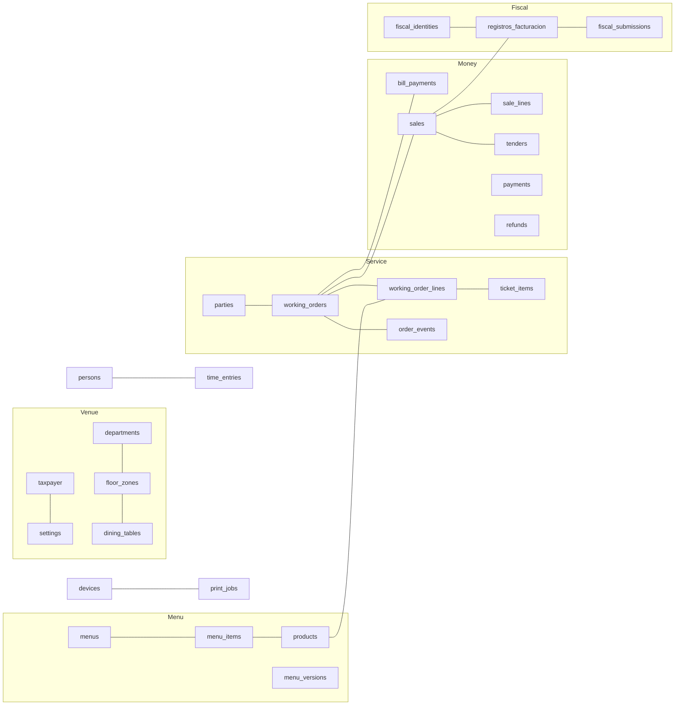

# Rationalising Waitron's tables, background jobs, environment variables and files — design

**Status:** proposal for the owner, 2 November 2026; refreshed 3 November 2026 against `main` at
`68732329c1` (A1317). Nothing is built until the owner approves it. First read on `main` at
`64eeabb036`. A773-2 PR B4b (#2440) landed just after the refresh's base; it adds two columns to
the device kitchen-screen tables and no table. The refresh re-checked every cited line in a file that changed since then, re-measured
every count, and rewrote U5 (the second box) around the handover work that has landed; each changed
paragraph carries a dated "refreshed" note. The artifact "Waitron Database Tables" still shows the
2 November mapping. The appendices in this folder hold the evidence: each cites the code
it rests on, and each lists what it did NOT establish.

| Appendix | What it covers |
| --- | --- |
| [tables-ordersales.md](tables-ordersales.md) | Open bills, ordering, sales, receipts, refunds |
| [tables-fiscal.md](tables-fiscal.md) | Veri\*Factu filing and chain, card payments, adjustments |
| [tables-floorkitchen.md](tables-floorkitchen.md) | Floor plan, tables, parties, bookings, kitchen, allergies |
| [tables-menu.md](tables-menu.md) | Menu, products, photos, purchasing and recipes |
| [tables-devices.md](tables-devices.md) | Devices, profiles, printers, print jobs, drawer opens |
| [tables-venuebox.md](tables-venuebox.md) | Taxpayer, venue, departments, calendar, the box itself, the shared `settings` table |
| [tables-people.md](tables-people.md) | People, sign-in, working time, rota, staffing |
| [jobs.md](jobs.md) | Background jobs |
| [environment.md](environment.md) | Environment variables and secrets |
| [files.md](files.md) | Files written to disk outside the database |

Each appendix is one researcher's proposal for one area, written to the shared rules in §3. Where
this document decides something differently (§5), **this document wins**.

---

## 1. Why

The owner, on seeing that Waitron has 242 database tables: "a ridiculously high number of tables
for a project like this. That tells me that it is over engineered and disjunct. Things don't fit
together in one clean picture. Each bit has been designed in isolation." The same review then
covered the background jobs, environment variables and files written to disk, and found the same
pattern in each. (refreshed 2026-11-03 against main 68732329c1: counts re-measured. Tables: 245,
from each migration set's latest drizzle snapshot, the method that gives exactly 242 at
`64eeabb036`; A1018 slice 1, #2417, added three. Jobs: 85 rows in `jobs.md`'s mapping table, 82
before A1018's three; the earlier "81" could not be reproduced. Environment variables: 221 entries,
one new test switch. Files: 86 kinds, one new since 2 November and one missed then.)

Nothing is live, so every database and every box may be reset. This is the cheapest moment there
will ever be to fix the shape.

## 2. Goals, non-goals, anti-goals

**Goal.** One picture a person can hold in their head: each real-world thing (a bill, a dish, a
table, a person, a device, an invoice record) lives in one obvious place, history is kept where it
matters, and settings are documents. The same for jobs (one way to run one), environment variables
(only what must be known before the database opens) and files (one layout, one owner per folder).

**Non-goals.**
- Changing what the product does. Where a merge would change behaviour, the appendix says so and it
  is listed as a decision (§10).
- Rewriting migration history step by step. A760's squash now runs **first**, extended to squash
  straight into U1's eight sets, and the slices then edit those fresh starting migrations (owner,
  2026-11-02, after the builder check found that the set merge cannot be done by adding migrations
  on top). A760's approved procedure (`docs/operations/a760-migration-squash.md`) gains that merge;
  its identical-schema check stays.
- Rewriting git history. That is A1306, later.

**Anti-goals** (owner, 2026-11-02: what would make this a failure even if the count went down):
- **Performance problems.**
- **Data loss** — including losing a protection that stops bad data getting in.
- **More complicated migrations or upgrades.**

§6 says how each is guarded against.

## 3. The rules

Agreed with the owner on 2 November 2026; R1–R11 were applied by every area.

- **R1. One table per real thing.** A side table keyed by its parent's id folds into the parent.
  It stays separate only if its rows have a different lifetime or protection from the parent's (for
  example the parent can never change but this fact arrives later).
- **R2. History where history matters.** A fact fixed when a row is written is a column of that
  row, even on a never-changed table. Things that change and must be auditable get an append-only
  history: a typed table when product code reads it back, or the shared `activity_log` when it is
  audit only.
- **R3. Settings are documents.** Switches, numbers, times and text that configure behaviour go
  into the module's document in the shared `settings` table. Things with identity, that other rows
  point at, that people see as a list, or that grow, stay tables.
- **R4. No row ids inside JSON.** A setting that chooses a row (the default menu, a receipt
  printer) becomes a flag or a checked column on a real table, because the database cannot stop an
  id inside JSON going stale.
- **R5. Delete what nothing uses.** A feature brings its own design back when it is built.
- **R6. One copy of each thing.** Pointers, counters and caches that can be read from their source
  go, unless a measurement shows they are needed.
- **R7. Link tables stay** when both sides are rows the database should check.
- **R8. Modules.** See §5, U1.
- **R9. Keep every protection.** Every trigger, unique index, foreign key and CHECK has a home in
  the new design, or is dropped with a stated reason (each appendix's §5).
- **R10. No "location".** One venue is one box (owner, 2026-11-01; A1301).
- **R11. Second box.** Tables that serve only a second box are kept when approved two-box work
  (A947, A1018) reads or writes them, although no venue runs two boxes yet; any other is deleted
  (§5, U5). (refreshed 2026-11-03 against main 68732329c1: was "kept only if that feature can run
  today", which would delete what landed A1018 code reads.)

**Shared tables, defined once:**

- **`settings`** (`venue.db`, core, `state`): `module` (primary key), `version` (the document's
  shape), `revision` (bumped on every save; a save names the revision it read, so a clashing save
  is refused), `doc` (JSON), `updated_at`, `updated_by`. One row per module. Each module declares its
  document's fields, defaults and validation in code. How it fits live updates, configuration
  export and backup verification is in §5, U2.
- **`activity_log`** (`venue.db`, core, `ledger`, append-only): `id`, `at`, `kind` (for example
  `drawer.opened`), `subject_kind`, `subject_id`, `person_id`, `device_id`, `data` (JSON), indexed
  on `(subject_kind, subject_id)` and on `(kind, at)`. Audit history that no hot path reads.
- The fiscal module keeps **its own** append-only history (`fiscal_history`), not `activity_log`.
- **`box_settings` is dropped from the design.** It was proposed for settings tied to one physical
  box; no area found anything that needs it (`tables-venuebox.md` §2, `environment.md` §1). The
  box's own facts become one `box` row in `node.db` (§4).

## 4. The one picture

**245 tables become 151**, in eight migration sets instead of sixteen (§5, U1). Of the 151, 119
keep a name a table has today, many with fewer or changed columns, and 32 have a new name: a
rename, a merge of several tables, or one of the four new tables (`settings`, `activity_log`,
`outgoing_mail` and `attendance_answer_entries`). Of today's 245, 20 are deleted (U6) and the other
106 are renamed or fold into another table, a settings document or a history. (refreshed 2026-11-03
against main 68732329c1: was "242 become 148", with a split that did not add up to 148. Measured by
matching this section's target list against the table names in each set's latest snapshot; the
three `node_handover_*` tables are kept, U5.) The full current-to-target mapping is in each appendix's §4, and
the artifact "Waitron Database Tables" shows it per table.

The target, grouped by the real thing each group is about:

| Real thing | Tables | Count |
| --- | --- | --- |
| **The venue** | `taxpayer`, `settings`, `departments`, `day_cutover_changes`, `seasons`, `special_days`, `special_day_dates`, `opening_hours` | 8 |
| **The box** | `nodes`, `deployment`, `node_membership`, `node_sealed_state`, `recovery_packs`, `incidents`, `change_log`, `venue_credentials`, `box` (node.db, with the second-box column groups, U5), `node_handover_operations`, `node_handover_events`, `node_handover_restriction` (node.db) | 12 |
| **The floor** | `floor_zones`, `dining_tables`, `floor_plan_sets`, `floor_plans`, `floor_plan_placements`, `table_merges` | 6 |
| **Guests** | `parties`, `party_tables`, `party_allergy_guests`, `allergy_line_ticks`, `bookings` | 5 |
| **An open bill** | `working_orders`, `working_order_lines`, `order_drafts`, `order_draft_lines`, `order_groups`, `order_group_hold_stations`, `order_events`, `order_amendments`, `order_kitchen_notes`, `service_commands`, `department_transfer_destinations`, `department_transfer_requests` | 12 |
| **The kitchen** | `kitchen_stations`, `kitchen_courses`, `station_printers`, `ticket_items`, `ticket_item_moves`, `kitchen_notices`, `kitchen_print_jobs`, `kitchen_print_job_lines`, `routing_cells`, `routing_cell_periods`, `service_steps`, `service_step_completions` | 12 |
| **Money on a bill** | `bill_payments`, `bill_payment_lines`, `refunds`, `payments`, `payment_refunds`, `card_readers`, `device_card_readers`, `device_profile_card_readers`, `scheduled_runs` | 9 |
| **The sale** | `sales`, `sale_lines`, `sale_line_dishes`, `tenders`, `sale_settlements`, `sale_substitutions`, `unpaid_departures`, `invoice_deliveries`, `invoice_series` | 9 |
| **Adjustments** | `adjustment_reasons`, `adjustments`, `adjustment_lines`, `adjustment_refunds` | 4 |
| **Fiscal filing** | `registros_facturacion`, `fiscal_submissions`, `fiscal_history`, `fiscal_identities`, `fiscal_sending_state`, `fiscal_certificates` | 6 |
| **The menu** | `menus`, `categories`, `products`, `units`, `menu_items`, `menu_item_variant_overrides`, `option_lists`, `option_labels`, `extra_lists`, `extra_list_items`, `product_modifiers`, `sections`, `section_members`, `menu_versions`, `menu_version_images`, `menu_releases`, `menu_periods`, `menu_period_staff_menus`, `content_suggestion_jobs`, `content_suggestions` | 20 |
| **Photos** | `media_images`, `media_blobs` | 2 |
| **Purchasing** | `ingredients`, `recipe_lines`, `purchase_invoices`, `purchase_invoice_vat` | 4 |
| **Devices and printing** | `devices`, `device_profiles`, `device_approved_profiles`, `device_approved_profile_zones`, `device_made_here_stations`, `device_profile_zones`, `device_profile_printers`, `device_profile_admission_persons`, `device_profile_admission_roles`, `kitchen_screens`, `kitchen_screen_stations`, `kitchen_screen_zones`, `join_requests`, `print_agents`, `printers`, `page_printers`, `print_jobs`, `drawer_opens`, `custom_themes` | 19 |
| **People and sign-in** | `persons`, `till_sessions`, `dashboard_sessions`, `sign_in_challenges`, `account_actions`, `recovery_codes`, `webauthn_credentials` | 7 |
| **Working time and rota** | `time_entries`, `roster_versions`, `shifts`, `shift_swaps`, `absences`, `attendance_days`, `staff_activity`, `attendance_questions`, `attendance_answers`, `attendance_answer_entries`, `staff_roles`, `person_staff_roles`, `staffing_days`, `staffing_blocks` | 14 |
| **Shared** | `activity_log`, `outgoing_mail` | 2 |
| | | **151** |

**What makes it one picture rather than seven:** a bill is one row and a dish is one row (today a
dish is spread over five tables); a physical table is one row (today seven); the fiscal chain's
head, the next invoice number and the next order number are read from the rows they describe
instead of being stored a second time; every setting of a module is in one document; every email
goes through one queue; every person id can be a checked key (§5, U1).

## 5. Decisions made across the areas

Each area met the same few questions and answered them in isolation; these answers make them one.

**U1. Eight migration sets instead of sixteen.** Today a module's tables live in its own migration
set, and a set may only point at sets applied before it. Every area hit this wall: bills could not
point at departments, products could not point at units, shifts could not point at staff roles,
and person ids everywhere are unchecked text because `persons` sits in a set the others cannot
require. Proposed rule: **a module that cannot be switched off keeps its code as a module, but its
tables go into the core set.** Only modules a venue can do without, or swap, keep their own set.

| Set after | Takes in | Why it stays separate |
| --- | --- | --- |
| `core` | core, catalogue, venue-service, media, adjustments (all `tier: "mandatory"`: `packages/composition/src/modules.ts:152, :177, :193, :371`, media in `packages/media/src/module.ts:32`), credentials, identity | — |
| `node` | node (`node.db`) | a different file |
| `workforce` | workforce, staffing | can be switched off |
| `workforce-es` | — | Spain-only rules |
| `payments` | payments, scheduler (its only user is Stripe reconciliation) | can be switched off |
| `bookings` | — | can be switched off |
| `fiscal-verifactu`, `fiscal-none` | — | the swappable fiscal slot |

Two parts of this are the owner's call (§10, decision 1): identity and credentials are
`toggleable` today (`packages/composition/src/modules.ts:214, :294`), and CLAUDE.md §3 has "a new
product domain lands as a MODULE" and "no new table enters the core migration set without a stated
reason in the commit". The code stays modular; only where the tables live changes, and this
section is the stated reason, which each slice's commit cites. (refreshed 2026-11-03 against main
68732329c1: credentials added; media's tier cite corrected. A1018's plan gives its later handover
tables a `venue.db` migration set of their own (its Slice 5), which would make nine; that plan and this
design have to agree before either builds it.)

**U2. How the shared `settings` table works** (`tables-venuebox.md` §2.4, read not run):
- *Live updates.* Today a change carries an id only when the table has a column named `id`, so a
  save to any settings row would wake every settings watcher. The change trigger emits
  `settings.<module>` as its type instead, and each module declares its key, so a save wakes only
  that module's screens.
- *Configuration export.* Today's import empties each declared table and rewrites ids only in key
  columns. Settings get their own path: each module says whether its document travels; import
  replaces only those rows, validates and upgrades them, and resets the revision.
- *Backups.* A document's shape is upgraded when it is read, and saved on the next save — never in
  a migration — or every older backup would fail verification.

**U3. One typed history for a bill's rounds and dishes: `order_events`.** The orders area sent the
round and dish events to `activity_log`; the people area found the attendance checker reads them by
person and day. They become one typed, append-only `order_events` table with a `(person, at)` index.
Three tables become one, and attendance gets an indexed source.

**U4. One queue for every notification email: `outgoing_mail`.** Five paths send mail today, with
two SMTP builders (`jobs.md` §1). Missing-times reminders (`attendance_mail`), certificate expiry
reminders (`fiscal_certificate_reminders`), box alerts and password-reset sends all become rows in
`outgoing_mail`, drained by one sender; box alerts and password resets then survive a restart.
Invoice emails keep `invoice_deliveries`, because it also carries the A4 print path and the
on-screen status; the same sender drains it.

**U5. Keep the second-box path that A947 and A1018 build on; take out only what neither uses.**
(refreshed 2026-11-03 against main 68732329c1: the 2 November text removed the adoption flow, the
mirror link, the pinned main-box key and the standby's reserved identity. Since then A1018 slices
1, 2, 3, 5a and the bench's slice 9 have landed — #2417, #2420, #2436, #2428, #2431 — and Slice 3
reads two of those parts.)

Adoption still cannot finish: it refuses `mirror.venue_not_copied` while the spare holds no venue
row (`apps/server/src/reserved-identity.ts:66-69`). But A947 (owner-approved 2026-10-22) finishes
it in its slice 3b, and A1018 already builds on it. At start, a box that lists another box checks
that box's signed answer with the key a spare pins at adoption (`peerKeyOf`,
`apps/server/src/handover-signing.ts:36-41`, which reads `node_primary_key`), and its certificate
with the one the mirror link holds (`readMirrorLink`, `apps/server/src/start-peer-check.ts:186-195`).
Adoption writes both, and nothing else does (`adopt.ts:179`, `:187`). The start check also uses
adoption's fetch code (`boxExchange`, `apps/server/src/boot-peer-check.ts:26, :347`).

- **Kept:** the adoption flow and its files; `node_mirror_link` and `node_primary_key`, as
  second-box column groups of `box`; the box's role and promotion, as `box` columns; the three
  handover tables, as tables of their own. `node_handover_operations` has many rows per box;
  `node_handover_events` is a history product code reads back, and cannot go to `activity_log`,
  which lives in `venue.db` and is overwritten by a copy; `node_handover_restriction` is written
  once and refuses a different value (`packages/node-db/src/handover.ts:5-20`), while `box` is
  rewritten on every role change. `WAITRON_TENANT_DOMAIN` is kept and renamed (U9): it sets the
  device cookie's domain so one credential reaches each of the venue's boxes after a promotion
  (`apps/server/src/config.ts:106-112`). A947 does not name it; that its switch slice needs it is
  inferred: A947 moves a till to the spare at a name beneath the venue's
  (`equipo-….waitron.local`, A947 :580-582, :757-764), which a cookie set only for the venue's own
  name would not reach. Not run.
- **Removed:** `fiscal_reservations`, the standby's reserved fiscal identity. A947 reserves no
  fiscal identity when a box joins (its §4 item 3), and the table's only writer is the
  allocated-standby path (`packages/fiscal-verifactu/src/standby-allocation.ts:184`). Removing it
  removes the paper-standby path with it (`allocation-preparation.ts:28`, the fallback in
  `allocated-standby.ts:163-210`, `activateDormant`'s read at `allocation.ts:274-279`), its
  name-history and backup-check readers, and the paper-standby case #2428 added to
  `dormant-takeover.test.ts`; A947 joins through the dormant path, which reserves nothing
  (`hour-dormant-standby.ts:247-277`). It is a fiscal slice, so the owner lands it.
- **Left to A947's slice 3b:** `WAITRON_MIRROR_ALLOW_EXPOSED`, because 3b decides how a spare
  listens on the network.
- **Cost:** three more tables than the 2 November count, and two fewer deleted. A1018's later
  slices add five more tables (`handover_activations`, `handover_gap_items`, `handover_gap_events`,
  `registros_devueltos`, `envios_devueltos`) and a migration set (U1); they are not counted here.

The owner's earlier standby decisions — 2026-09-03 (a standby gets its dormant identity at join)
and W41s-4's decision A (2026-10-12: "reserve at join, switch on at takeover") — were superseded
by A679 (approved 2026-10-16: "Keep it dormant without reserving a future hour"), which A947 keeps
(A947 design :418-424, :572-574). Decision 2.

**U6. Delete 20 tables** that are dead, have no product writer, or serve something not built.
(refreshed 2026-11-03 against main 68732329c1: was 23. `node_mirror_link` and `node_primary_key`
are kept as `box` columns (U5). `filing_case_events` now has writers: W41s-8 (#2399) records a
case's resolution and notes through it (`tables-fiscal.md` §0), so it splits into
`fiscal_submissions` columns and a `fiscal_history` kind instead; no remedy is switched on yet.) The
feature returns with its own design when it is built.

| Deleted | Why | Evidence |
| --- | --- | --- |
| `pass_item_marks`, `clock_stop_restarts` | dead: their writers were removed | `tables-floorkitchen.md` §4; `tables-fiscal.md` §4 |
| `tenant_receipts` | no caller outside its own store | `tables-devices.md` §4 |
| `acks` | written, never read; repeats `envios` | `tables-fiscal.md` §4 |
| `cadenas`, `working_order_counters`, `workforce_chains` | a pointer or counter read from its source instead (R6) | `tables-fiscal.md` §0.1; `tables-ordersales.md` §4; `tables-people.md` §9 D6 |
| `attendance_source_state` | ~1 million bookkeeping rows a year; the checker already reads the sources | `tables-people.md` §4 |
| `device_kitchen_screen_removals` | derivable when a profile is saved | `tables-devices.md` §9 D1 |
| `fiscal_reservations` | the standby's reserved identity; A947 reserves none when a box joins | U5; `tables-fiscal.md` §9 decision 1 |
| `daily_closes`, `daily_close_chain` | the end-of-day close: built, no route calls it | `tables-fiscal.md` §9 D2 |
| `sale_voids` | voiding a sale: no till screen or route calls it | `tables-ordersales.md` §9 D3 |
| `payment_policy` | taking cards while the card network is down: nothing can switch it on | `tables-fiscal.md` §9 D3 |
| `pay_period_closures`, `pay_period_settings`, `employments`, `convenio_config`, `availability`, `shift_templates` | no product writer | `tables-people.md` §9 D2 |

Removing `pay_period_closures` changes an input to the working-time record's hash
(`packages/workforce/src/chain-hash.ts:91`): harmless before go-live, impossible after it.
`sale_voids`, the daily close and `fiscal_reservations` touch fiscal code, so those slices wait for
the owner to land them (owner, 2026-10-21: truly fiscal PRs wait for the owner).

**U7. Secrets: one owner, three files, one store.** `secrets.env` holds the root keys (vault key
ring and account key), `backup.env` the backup recovery key, `trading.env` identity only; every
other secret lives sealed in `venue_credentials` (`environment.md` §6 D4). One file was proposed
and does not hold: restore treats the three differently (it writes `trading.env` last as its commit
point, and a Waitron Cloud managed restore drops the archive's `backup.env`,
`apps/server/src/restore.ts:557-561, 795-812`; refreshed 2026-11-03 against main 68732329c1: the
drop happens only on a managed restore). Settings that are sealed
today but are not secret (the SMTP sender, Stripe's return addresses, the bucket's name and region,
the backup settings) move to their module's settings document; only the secret values stay sealed
(`tables-venuebox.md` §9 D7).

**U8. A1301 (removing "location") continues, except slice S23.** Its column-stripping slices go
ahead as designed. S23's new `venue_settings`, `venue_catalogues` and `business_day_settings`
tables are replaced by the `settings.venue` / `settings.business_day` documents and two flags on
`menus` (`is_default`, `offered`); its fourth, `day_cutover_changes`, stays a table (§4)
(`tables-menu.md` §9 D2; `tables-venuebox.md` §9 D1; A1301 design :620). The two flags also
change the configuration bundle: format 10 (#2415) carries the default menu as the top-level
`defaultCatalogueId`, and CLAUDE.md §3's bundle rule names it (`tables-menu.md` §1.1).
(refreshed 2026-11-03 against main 68732329c1: S23 creates four tables, not two; S20–S28 have a
design but no plan yet.)

**U9. Renames, done in the same reset** since each table changes shape anyway: `catalogues` →
`menus`, `sale_line_portions` → `sale_line_dishes`, `registro_sif` → `fiscal_identities`, `envios`
→ `fiscal_submissions`, `envio_flujo` → `fiscal_sending_state`, `fiscal_certificate_installs` →
`fiscal_certificates`, `sessions` → `till_sessions`, `management_sessions` → `dashboard_sessions`,
`floor_today_joins` → `table_merges`, and the people area's attendance renames
(`tables-people.md` §9 D8).

**No name says "tenant" any more** (owner, 2026-11-02). The word is left over from the retired
design in which one database held several businesses. A name that means the taxpayer says
`taxpayer`: the `tenants` table becomes `taxpayer`, its checks `tenants_singleton_ck` and
`tenants_country_tax_id_key` become `taxpayer_singleton_ck` and `taxpayer_country_tax_id_key`, and
the helpers, types, files and error codes that name it follow (for example `seedTenant`,
`readTenant`, `setupTenant`, `TENANT_A`, `packages/provisioning/src/tenant-guard.ts`,
`provisioning.foreign_tenant`, `provisioning.tenant_identity_mismatch`). A name that means the
venue or the box says that instead: `tenant_credentials` becomes `venue_credentials`, and index
names such as `persons_tenant_email_uq` drop the word. `tenant_receipts` is deleted anyway (U6),
and `WAITRON_TENANT_DOMAIN` becomes `WAITRON_VENUE_DOMAIN` (name proposed), the device cookie's
domain across the venue's boxes (`apps/server/src/config.ts:106-112`; U5; refreshed 2026-11-03
against main 68732329c1: it was deleted with the second-box path). The fiscal module's leftovers
(`registros_tenant_node_secuencia_uq`, `TenantTransport`, the filing pass's `tenantsWithWork` and
its `drain.tenant_skipped` log line) are renamed in the fiscal slice, which the owner lands. The
shared test helpers are renamed in the venue-and-box slice; each other area renames its own.
`scripts/no-tenant-column.test.ts` stays, since it stops the old `tenant_id` column coming back,
and CLAUDE.md §3's "There is no tenant column" rule is reworded in the venue-and-box slice.

**U10. Retention stays with A980.** The approved data-protection design (A980, built on A664's
gates) says nothing that holds personal data or evidence is deleted on a timer until the tax
adviser, the labour specialist and the privacy specialist agree a period (G1–G3), and records that
can never change need their own decision (G5)
(`docs/superpowers/specs/2026-10-22-a980-data-protection-design.md` lines 100–102 for the gates,
and 746–747: "Nothing proposed here deletes evidence or runs on a timer before the specialists
agree"; refreshed 2026-11-03: cite corrected). So this design
prunes only what holds neither: expired sign-in challenges, and replaced photos' bytes once no
photo names them. Everything else the appendices propose to prune (`service_commands`,
`staff_activity`, ended `till_sessions` and `dashboard_sessions`, print job payloads) is handed to
A980 as a proposal with its growth figure, and the bench measures it unpruned.

**U11. Calls made after the builder check** (the builder's questions and how each was settled):
- *Card readers on a device.* A core table cannot hold a key into the switchable `payments` set, so
  `device_card_readers` stays a link table in `payments` instead of becoming `devices.card_reader_id`
  (`tables-fiscal.md` §1.3 is overridden). That is one of the 151 (refreshed 2026-11-03: was 148).
- *Person ids.* With identity in core (U1), every column naming a person gets a key to `persons`
  where its set can see core — every set does. The on-delete rule follows A980's erasure design,
  which anonymises a person rather than deleting the row; until a row can be deleted, the key
  refuses deletion. Test fixtures that invent person ids create a person first.
- *`activity_log` scope.* This work writes only the kinds that replace a table or a value that is
  overwritten today. The new audit kinds the appendices propose (person changes, device approvals,
  card readers, adjustment reasons, allergy answers, station closures) are listed as follow-ups,
  not built here.
- *The bench.* Pass and fail compare before and after on the same machine. The absolute figures in
  the appendices are taken on the reference micro PC when one is available, not on a developer Mac.
- *Which slices the owner lands.* Every slice that changes `sales`, invoice numbering,
  `registros_facturacion`, the fiscal identity, AEAT sending, or any value that feeds a fiscal hash
  (including the venue's time zone, which since A696 sets every invoice's time offset,
  `packages/fiscal/src/issue-clock.ts:7-23`, and the operation description; refreshed 2026-11-03:
  A696 had already landed, #2369) — following the
  owner's rule of 2026-10-21 that truly fiscal pull requests wait for the owner. The working-time
  record's hash change (U6) is a labour record, not fiscal; it is flagged in its pull request.
- *Other work on the same tables.* A1301's code slices S1–S17 and its fixture slices F1–F5 have
  landed (`docs/backlog.md:6420-6422`); S18 (contract and type clean-up) and S19 (text sweep)
  finish first on their lane; its schema slices S20–S28, which have a design but no plan yet
  (A1301 plan :124-125), are absorbed into this design's venue-and-box slice. Until then every
  new row still fills its `location_id` from the venue's one location (for example
  `working-order.ts:1722`). A1018's remaining slices (Slice 4 is in flight on lane A) build on the
  node.db tables U5 keeps. (refreshed 2026-11-03 against main 68732329c1.) A773-2 (tickets),
  A1089 (filing cases) and A980 (people) land before the slice that touches their tables, or are
  re-planned onto the new shape. One lane runs this work, because every slice edits the shared lists
  (classification, configuration export, live subscriptions, guards).
- *Waitron Cloud.* Its test script and integration contract change in the same slice that changes
  the Waitron side (U5, U7), by the Cloud lane.

## 6. How the three worries are answered

**Performance.** Nothing lands on reasoning alone.
- *Slice 0 builds a bench:* a reference venue with a year of trading (about 10 million rows on
  today's schema), and timings of the paths that matter before and after each slice — taking a
  payment, recording a sale, a filing pass, a till's floor read, the kitchen screen, opening the
  dashboard.
- *The specific reads each area flagged* are measured in the slice that introduces them, with the
  result that would change the design written down in advance (each appendix's §8). The main ones:
  - the chain head and next invoice number read from records and sales instead of stored
    (`tables-fiscal.md` §8.1 — fails on a table scan or a slower sale write; then `cadenas` and
    `next_number` stay);
  - wider bill-line rows on the till's bill read (`tables-ordersales.md` §8 M2);
  - attendance reading `order_events` (§8 M6);
  - the line triggers reading the venue's languages from a JSON document (`tables-venuebox.md` §8);
  - `json_extract` CHECKs on `fiscal_history` firing on the app's own SQLite engine
    (`tables-fiscal.md` §8.4 — fails if any check does not fire; that field becomes a column).
- *Every `venue.db` write still takes that file's one write lock* (`packages/db/src/tenancy.ts:35`;
  `node.db` has its own, `:45-53`; refreshed 2026-11-03: narrowed). Giving tills a live
  connection (§7) needs a session check that does not take that lock (`jobs.md` §6).

**Data loss.**
- *No data is carried over:* every box is reset into the new schema, as A760 already plans for its
  squash. So the risk is losing a protection, not losing rows in a move.
- *Every protection has a home:* each appendix's §5 lists every current trigger, unique index,
  foreign key and CHECK and where it goes. A slice's review checks its list.
- *The behaviour suites stay* with unchanged assertions; tests are re-pointed at new tables, never
  rewritten to match (owner's rule).
- *The guards are updated, not loosened:* `scripts/append-only-triggers.test.ts`,
  `scripts/behavioural-triggers.test.ts`, `scripts/schema-constraints.test.ts`,
  `scripts/classification-complete.test.ts`, `scripts/live-subscriptions.test.ts`.
- *The fiscal record is untouched:* `registros_facturacion` keeps its 38 columns (34 until W41s-8,
  #2399, added four for corrections; refreshed 2026-11-03), its checks and its append-only triggers; only the tables around it change. Fiscal slices are landed by the owner.

**Migrations and upgrades.**
- *A760 runs first* (owner, 2026-11-02): it squashes today's history into one starting migration
  per set, merged straight into U1's eight sets, with its identical-schema check comparing the
  squashed schema against today's. Each later slice then edits those starting migrations instead of
  adding steps, so no slice meets the table-rebuild hazards CLAUDE.md §3 lists.
- *Every slice resets the dev venues* — the laptop dev-stack slots and the Santet venue — instead of
  migrating data (CLAUDE.md §3, "no backwards-compatibility code until production"; editing a
  shipped migration is named in the pull request's first line). The owner's own box stays
  quarantined and is reset once, at the end.
- *After go-live,* a settings document's shape changes through a version number and one tested
  upgrade step per version, applied on read (U2). That is the one new kind of upgrade this design
  adds.

## 7. Background jobs, environment variables and files

The same treatment, in brief; the appendices hold the detail and the mappings.

**Background jobs** ([jobs.md](jobs.md)): 85 inventory entries; the 2 November count of 82 was to
become about 63. (refreshed 2026-11-03 against main 68732329c1: A1018 added three — the start-up
peer check, the waiting start's re-ask every 15 seconds, and the stepdown's close and restart. The
first two stay their own jobs outside the runner, the third moves onto it; "about 63" was not
re-derived.)
- *One job runner* in the server replaces about twenty hand-built loops written four different
  ways. Every job is declared to it with when it applies, which data changes wake it, its sleeps,
  back-off and health budget. The runner re-checks the box's role before every pass (six duties
  check it only at start today), contains failures, reports every job to `/health`, raises one
  alert for a job that keeps failing, and stops everything in parallel. Since A1018 slice 2 (#2420)
  a box can also step down without restarting first: each job record then says whether it stops
  at a stepdown or why it waits, which today's closer table already requires
  (`apps/server/src/background-duties.ts:85-214`), and the runner starts nothing on a box that
  starts restricted (refreshed 2026-11-03).
- *Jobs wake on data changes, and poll only as a safety net.* The fiscal filing loop wakes on a new
  sale, so a sale no longer waits up to an hour to be filed; AEAT's wait between sends is still
  enforced by the filing code itself (`drain.ts:255`; refreshed 2026-11-03: was :242).
- *Merged:* the card payment check loop's four steps and card refund recovery become one card
  follow-up job; the five email paths become one sender (U4).
- *Tills get one live connection,* with the find-the-primary probe running only while it is down,
  instead of each screen polling every 5–15 seconds.
- *Off on production:* the practice email inbox (Mailpit).

**Environment variables** ([environment.md](environment.md)): the product's 111 `WAITRON_*` names →
53. (refreshed 2026-11-03 against main 68732329c1: was 51. The 2 November count left out
`WAITRON_ACCOUNT_KEY`, which moves file but keeps its name, and U5 now keeps
`WAITRON_TENANT_DOMAIN`, renamed; `WAITRON_MIRROR_ALLOW_EXPOSED` waits for A947's slice 3b. The one
new name since 2 November, `WAITRON_TEST_CRASH_AT`, is a test switch.)
- *An environment variable is only for what the box must know before its database opens:* folders
  and ports, image wiring, the box's identity, its root keys, and one-off inputs to commands an
  operator types.
- *Venue choices* (tips, display language, the practice card provider, Google sign-in) move to
  settings documents.
- *Knobs nobody sets* (loop timings, scheduler settings, log rotation) become constants.
- *Backups are configured only on the dashboard;* today an environment variable silently takes over
  and locks the screen.
- *One module lists every variable;* the box names unknown `WAITRON_*` variables at start and
  refuses a retired one whose silent loss would cost data.
- *Test switches leave the production scripts* for four `WAITRON_TEST_*` names.
- *The dead `WAITRON_FISCAL_*` set goes* (its own fiscal PR).

**Files** ([files.md](files.md)):
- *A file outside the database must earn its place,* for one of seven reasons: needed before the
  database opens; must outlive the database; a secret kept out of backups; a lock; a log; a backup;
  or owned by another program.
- *One folder per flow* (setup, restore, TLS repair) holding one record plus its attachments,
  ended with one rename.
- *Everything temporary goes under `<state>/scratch/`,* emptied at every start; today two of seven
  kinds of leftover are swept.
- *One durable write everywhere:* the most used helper today does not flush to disk.
- *The TLS repair archive keeps only its newest copy,* not every old private key forever.
- *A plain reset keeps exactly two folders,* `tls/` and `records/`.
- *`modules.json` moves into `settings`* if core's tables can migrate before modules are read.

## 8. Features and what they cost in tables

The rules above remove what is unused, duplicated or split for internal reasons. What remains is
mostly features that are built. If the count is still too high, the lever is the product: a
feature dropped takes its tables with it. Nothing here says a feature is unused — that is the
owner's knowledge, not the code's.

| Feature | Tables |
| --- | --- |
| Working-time checker and its questions to staff | 5 (`attendance_days`, `staff_activity`, `attendance_questions`, `attendance_answers`, `attendance_answer_entries`) |
| Seasons, special days and opening hours | 5 (`seasons`, `special_days`, `special_day_dates`, `opening_hours`, `day_cutover_changes`) |
| Staffing by role | 4 (`staff_roles`, `person_staff_roles`, `staffing_days`, `staffing_blocks`) |
| Rota, swaps and absences | 4 (`roster_versions`, `shifts`, `shift_swaps`, `absences`) |
| Purchasing and recipes | 4 |
| Adjustments (cancel, comp, discount) | 4 |
| Kitchen screens' station and zone choices | 3 |
| Floor plan sets and layouts per department | 3 (plus `table_merges`) |
| Published menu versions and scheduled releases | 3 |
| Department transfers (moving a bill between departments) | 2 |
| Kitchen routing by menu period | 2 |
| Menu periods and staff menus | 2 |
| Service-step reminders | 2 |
| Allergy tracking at the table | 2 (plus columns) |
| Translation suggestions from Waitron Cloud | 2 |
| Who may sign in on a device profile | 2 |
| Second box and handover (U5) | 3 (`node_handover_*`) plus two column groups on `box`; A1018 plans 5 more |
| Bookings | 1 |
| Custom themes | 1 |
| A4 office printers | 1 |

The working-time record itself (`time_entries`) is a legal duty in Spain and is not optional.

## 9. Order of work

Each slice gets its own plan, written after this design is approved. The order (proposed):

1. **Slice 0 — the bench and the protection inventory.** The year-of-trading dataset, the timing
   harness, and a script that lists every protection in the schema, run before and after each
   slice.
2. **A760's squash, into U1's eight sets** (owner, 2026-11-02). No table changes shape; its
   identical-schema check proves it. Moving catalogue's, venue-service's, media's, adjustments',
   credentials' and identity's table definitions into `@waitron/db` comes with it, since those
   packages depend on `@waitron/db` and core's set cannot import them.
3. **The shared tables:** `settings` (with U2's plumbing), `activity_log`, `outgoing_mail`.
4. **One slice per area,** each landing behind the bench: venue and box (with A1301's remaining
   slices, U8), menu and photos, floor and kitchen, devices and printing, orders and sales, people
   and working time, payments and adjustments, then **fiscal** (landed by the owner).
5. **The job runner,** then the jobs moved onto it; then tills' live connection.
6. **Environment variables and secrets** (U7), then **the file layout**.
7. **A1306**: rewrite git history.

## 10. Decisions for the owner

Ranked by how much they change what gets built. Each appendix's §9 holds the area-level decisions
behind these, with their evidence.

1. **Eight migration sets (U1),** including making identity and credentials mandatory so every
   person id can be a checked key, and the CLAUDE.md §3 wording that goes with it. A1018's plan
   adds a `handover` set in its Slice 5; the two have to agree (refreshed 2026-11-03). *Recommend yes.* Without it, about
   ten merges in four areas fall back to plain ids or stay separate tables.
2. **Keep the second-box path that A947 and A1018 build on (U5).** *Recommend yes.* A1018 has
   landed four pull requests on it (#2417, #2420, #2428, #2436), plus the bench's re-run (#2431);
   A947's slice 3b, approved, finishes adoption; and the go-live goal is one box with failover to
   another local box (owner, 2026-10-21, A947). Only `fiscal_reservations` goes, with the paper
   standby path that writes it. Cost: the box group is 12 tables, not 9, and two column groups on
   `box`; A1018's later slices add five more tables and a ninth migration set when they land.
   Waitron Cloud's hosted-venue design (2026-10-21) also plans Cloud standbys and its integration
   contract names `adopt.ts`; keeping adoption keeps what that work expects. (refreshed 2026-11-03
   against main 68732329c1: was "take out the unfinished second-box path".)
3. **Delete the unbuilt features' tables (U6):** the end-of-day close, voiding a sale, taking cards
   offline, pay periods, employments, convenio rules, availability, shift templates. *Recommend
   yes;* each comes back designed when built. Five of the six people tables travel in the
   configuration bundle today, so deleting them changes the bundle (`tables-people.md`; refreshed
   2026-11-03).
4. **One `order_events` history (U3) and one `outgoing_mail` queue (U4).** *Recommend yes.*
5. **One row per physical table on the floor** — seven tables into `dining_tables`, about 45
   columns in four named groups (`tables-floorkitchen.md` §9 D1). *Recommend yes;* the floor's
   behaviour suites are the safety net.
6. **One `refunds` table** for money returned before and after the invoice
   (`tables-ordersales.md` §9 D4). *Recommend yes,* in its own slice, because it touches money
   paths.
7. **Card payment resolutions and holds as columns on `payments`,** with a new guard trigger
   (`tables-fiscal.md` §9 D5). *Recommend yes.*
8. **Backups configured only on the dashboard** (`environment.md` §6 D1). *Recommend yes.*
9. **Keep AEAT answers that reconcile clears** in `fiscal_history` (`tables-fiscal.md` §9 D6).
   *Recommend yes.*
10. **Smaller behaviour changes the appendices recommend,** approved or refused together with this
    design:
    - merging two parties also moves their settled bills, so one party numbers them
      (`tables-ordersales.md` D6);
    - a kitchen display no longer lists stations removed from its profile as "no longer available"
      (`tables-devices.md` D1);
    - withdrawing a device's approval for a profile also forgets the floor zones it chose under it
      (`tables-devices.md` D4);
    - the venue's operation description is deleted and becomes a required input when a sale is
      recorded — fiscal, so the owner lands it (`tables-venuebox.md` D3). Since A1315 part 5
      (#2441) setup no longer asks for it and the server stores the filing module's default
      (`apps/server/src/setup-api.ts:502-507`), so deleting it removes no input the setup wizard
      asks for; the provisioning command line and the configuration bundle still carry one
      (`packages/provisioning/src/cli.ts:217-218`, `configuration-transfer.ts:41`) (refreshed
      2026-11-03);
    - the display-language override moves to settings, or is deleted if staff never need a language
      other than the venue's (`environment.md` D5);
    - a chosen first-setup backup recovery is moved into the real folders, and the venue folder is
      fixed inside the state folder (`files.md` D2, D4);
    - the print agent waits on a held request instead of asking every 2 seconds, if measured
      worthwhile (`jobs.md` D3).
11. **Features (§8):** any feature the owner would rather not have.
12. **The venue's stable id** (added 2026-11-03). Today the location row's id names the backup
    bucket's folder and is Waitron Cloud's pairing value (`tables-venuebox.md` §2.1, read, not
    run). The A1301 plan lists it as a point to settle before S18 and recommends the venue keeps a
    stable id that a restore carries (`2026-11-01-a1301-remove-location.md:454-470`). If kept,
    under this design it is a plain field of `settings.venue`, carried by a restore and not by
    configuration transfer.
    *Pointer 2026-11-04 (lane B):* the owner decided this on 2026-11-02 (Cloud assigns the id), replacing the recommendation above; see [`2026-11-04-a1301-venue-id-design.md`](../2026-11-04-a1301-venue-id-design.md).

## 11. Left to the builder

- The exact column lists, within each appendix's §1, and their names in code.
- How each slice is split into tasks, and the order of areas within step 4 of §9, provided fiscal
  is last and landed by the owner.
- Where a measurement fails, the fallback each appendix names (keep the pointer, keep the side
  table, keep the column).
- The wording of new error codes, following CLAUDE.md §3.
