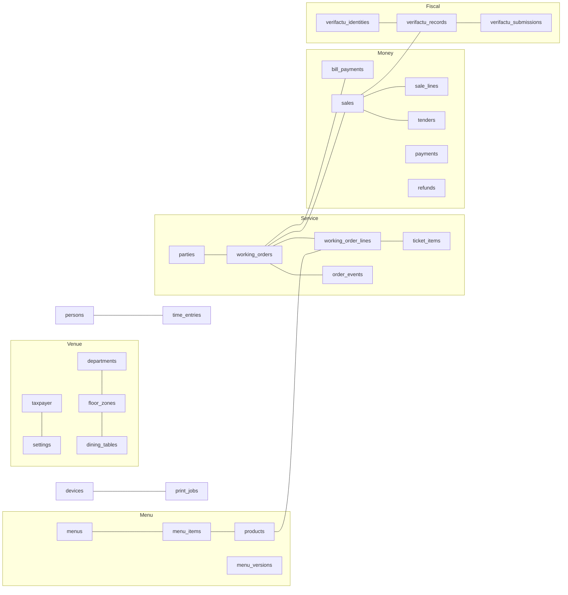

# Rationalising Waitron's tables, background jobs, environment variables and files — design

> **2026-11-10, A947 3b-4:** the bind guard (`mirror-bind-guard.ts`), `server.mirror_bind_exposed` and
> `WAITRON_MIRROR_ALLOW_EXPOSED` are gone: a spare listens on the venue's network, and on a mirror both
> promotion routes answer only a request from the box itself (`promotion.from_box_only`, `promote-api.ts`).
> Rows below that name them describe the code before that change.
>
> **2026-11-08, A1113:** the ambient mirror viewer and its keepalive are removed. Existing viewer-session
> revocation remains at boot. The bind guard and `WAITRON_MIRROR_ALLOW_EXPOSED` remain for the
> promotion routes; how a spare listens on the network stays with A947 slice3b.
> The authenticated spare switch screen belongs to A947.

**Status:** approved by the owner, 4 November 2026, after a file-by-file review. Their decisions are
applied here and in every appendix, and §10 lists them.
Counts and cites were checked against `main` at `e0da0ad18a`. The appendices hold the evidence: each
cites the code it rests on, and each says what it did not establish. The artifacts published on
2 November still show the earlier proposal.

| Appendix | What it covers |
| --- | --- |
| [tables-ordersales.md](tables-ordersales.md) | Open bills, ordering, sales, receipts, refunds |
| [tables-fiscal.md](tables-fiscal.md) | Veri\*Factu filing and chain, card payments, adjustments |
| [tables-floorkitchen.md](tables-floorkitchen.md) | Floor plan, tables, parties, bookings, kitchen, allergies |
| [tables-menu.md](tables-menu.md) | Menu, products, photos and supplier invoices |
| [tables-devices.md](tables-devices.md) | Devices, profiles, printers, print jobs, drawer opens |
| [tables-venuebox.md](tables-venuebox.md) | Taxpayer, venue, departments, calendar, the box itself, the shared `settings` table |
| [tables-people.md](tables-people.md) | People, sign-in, working time, rota, staffing |
| [jobs.md](jobs.md) | Background jobs |
| [environment.md](environment.md) | Environment variables and secrets |
| [files.md](files.md) | Files written to disk outside the database |

Each appendix is one researcher's proposal for one area, written to the shared rules in §3. Where
this document decides something differently (§5), **this document wins**.

---

## 1. Why

The owner, on seeing that Waitron had 242 database tables: "a ridiculously high number of tables
for a project like this. That tells me that it is over engineered and disjunct. Things don't fit
together in one clean picture. Each bit has been designed in isolation." The same review then
covered the background jobs, environment variables and files written to disk, and found the same
pattern in each. Today's counts: 246 tables, from each migration set's latest drizzle snapshot; 87
rows in `jobs.md`'s mapping table; 221 environment variable entries; 87 kinds of file.

Nothing is live, so every database and every box may be reset. This is the cheapest moment there
will ever be to fix the shape.

## 2. Goals, non-goals, anti-goals

**Goal.** One picture a person can hold in their head: each real-world thing (a bill, a dish, a
table, a person, a device, an invoice record) lives in one obvious place, history is kept where it
matters, and settings are documents. The same for jobs (one way to run one), environment variables
(only what must be known before the database opens) and files (one layout, one owner per folder).

**Non-goals.**
- Changing what the product does. Where a merge would change behaviour, the appendix says so and it
  is listed as a decision (§10).
- Rewriting migration history step by step. A760's squash now runs **first**, extended to squash
  straight into U1's eight sets, and the slices then edit those fresh starting migrations (owner,
  2026-11-02, after the builder check found that the set merge cannot be done by adding migrations
  on top). A760's approved procedure (`docs/operations/a760-migration-squash.md`) gains that merge;
  its identical-schema check stays.
- Rewriting git history. That is A1306, later.

**Anti-goals** (owner, 2026-11-02: what would make this a failure even if the count went down):
- **Performance problems.**
- **Data loss** — including losing a protection that stops bad data getting in.
- **More complicated migrations or upgrades.**

§6 says how each is guarded against.

## 3. The rules

Agreed with the owner on 2 November 2026 and amended in their review of 4 November.

- **R1. One table per real thing.** A side table keyed by its parent's id folds into the parent.
  It stays separate only if its rows have a different lifetime or protection from the parent's (for
  example the parent can never change but this fact arrives later).
- **R2. History where history matters.** A fact fixed when a row is written is a column of that
  row, even on a never-changed table. Things that change and must be auditable get an append-only
  history: a typed table when product code reads it back, or the shared `activity_log` otherwise.
  **`activity_log` is for people to read; product logic never makes a decision from it** (owner,
  2026-11-04).
- **R3. Settings are documents.** Switches, numbers, times and text that configure behaviour go
  into the module's document in the shared `settings` table. Things with identity, that other rows
  point at, that people see as a list, or that grow, stay tables.
- **R4. No row ids inside JSON,** with one exception. A setting that chooses a row (the default
  menu, a receipt printer) becomes a flag or a checked column on a real table, because the database
  cannot stop an id inside JSON going stale. The exception (owner, 2026-11-04): a short list owned by
  one row may be JSON, such as a profile's printers, a station's printers or a period's staff menus.
  The cost is stated wherever one is used: the code must clear a deleted id, and configuration import
  must rewrite these ids, which it does not do today.
- **R5. Delete only what is dead, replaced, or dropped by the owner.** Something built and sound
  stays even if nothing uses it yet, unless planned work will change it substantially (owner,
  2026-11-04).
- **R6. One copy of each thing.** Pointers, counters and caches that can be read from their source
  go, unless a measurement shows they are needed.
- **R7. Link tables stay** when both sides are rows the database should check.
- **R8. Modules.** See §5, U1.
- **R9. Keep every protection.** Every trigger, unique index, foreign key and CHECK has a home in
  the new design, or is dropped with a stated reason (each appendix's §5).
- **R10. No "location".** One venue is one box (owner, 2026-11-01; A1301).
- **R11. Second box.** Tables that serve only a second box are kept when approved two-box work
  (A947, A1018) reads or writes them, although no venue runs two boxes yet; any other is deleted
  (§5, U5).
- **R12. A table in a swappable module is named after the module, not the slot,** such as
  `verifactu_records` (owner, 2026-11-04).

**Shared tables, defined once:**

- **`settings`** (`venue.db`, core, `state`): `module` (primary key), `version` (the document's
  shape), `revision` (bumped on every save; a save names the revision it read, so a clashing save
  is refused), `doc` (JSON), `updated_at`, `updated_by`. One row per module. Each module declares its
  document's fields, defaults and validation in code. How it fits live updates, configuration
  export and backup verification is in §5, U2.
- **`activity_log`** (`venue.db`, core, `ledger`, append-only): `id`, `at`, `kind` (for example
  `drawer.opened`), `subject_kind`, `subject_id`, `person_id`, `device_id`, `data` (JSON), indexed
  on `(subject_kind, subject_id)`, `(kind, at)`, `(at)` and `(person_id, at)`. The last two serve a
  dashboard history screen, a separate item the owner wants, and the personal-data export. It holds
  no hot path. The order dialog shows reprints and PDF downloads, so `activity_log` must be a live
  update source, or that dialog refreshes after those two actions (`apps/dashboard/src/api/live-queries.ts:269, :273`).
- **`outgoing_mail`** (`venue.db`, core, `state`): the one mail queue, drafted in `jobs.md` §2.
- The Veri\*Factu module keeps **its own** append-only history (`verifactu_history`), not `activity_log`.
- The box's own facts are one `box` row in `node.db` (§4).

## 4. The one picture

**246 tables become 145**, in eight migration sets instead of sixteen (§5, U1), or 144 once A1323
removes `recovery_packs`. Of the 145, 113 keep a name a table has today, many with fewer or changed
columns, and 32 have a new name: a rename, a merge of several tables, or a new table. Of today's
246, 15 are deleted (U6) and the other 118 are renamed or fold into another table, a settings
document or a history. Measured by matching this section's target list against the table names in
each set's latest snapshot; every table leaving the list has a mapping row in its appendix. The full
current-to-target mapping is in each appendix's §4.

The target, grouped by the real thing each group is about:

| Real thing | Tables | Count |
| --- | --- | --- |
| **The venue** | `taxpayer`, `settings`, `departments`, `day_cutover_changes`, `seasons`, `special_days`, `special_day_dates`, `opening_hours` | 8 |
| **The box** | `nodes`, `deployment`, `node_membership`, `node_sealed_state`, `recovery_packs` (until A1323), `incidents`, `change_log`, `venue_credentials`, `box` (node.db, with the second-box column groups, U5), `node_handover_operations`, `node_handover_events`, `node_handover_restriction` (node.db) | 12 |
| **The floor** | `floor_zones`, `floor_plan_tables`, `dining_tables`, `floor_reset_tables`, `floor_plan_sets`, `floor_plans`, `floor_plan_placements`, `table_merges` | 8 |
| **Guests** | `parties`, `party_tables`, `party_allergy_guests`, `allergy_line_ticks`, `bookings` | 5 |
| **An open bill** | `working_orders`, `working_order_lines`, `order_drafts`, `order_draft_lines`, `order_groups`, `order_group_hold_stations`, `order_events`, `order_amendments`, `order_kitchen_notes`, `service_commands`, `department_transfer_destinations`, `department_transfer_requests`, `line_service_cancellations` | 13 |
| **The kitchen** | `kitchen_stations`, `kitchen_courses`, `ticket_items`, `ticket_item_moves`, `kitchen_notices`, `kitchen_print_jobs`, `kitchen_print_job_lines`, `routing_cells`, `routing_cell_periods`, `service_steps`, `service_step_completions` | 11 |
| **Money on a bill** | `bill_payments`, `bill_payment_lines`, `refunds`, `payments`, `payment_refunds`, `card_readers`, `reconciliation_runs` | 7 |
| **The sale** | `sales`, `sale_lines`, `sale_line_dishes`, `tenders`, `sale_settlements`, `sale_substitutions`, `sale_voids`, `unpaid_departures`, `invoice_deliveries`, `invoice_series`, `daily_closes` | 11 |
| **Adjustments** | `adjustment_reasons`, `adjustments`, `adjustment_lines`, `adjustment_refunds` | 4 |
| **Veri\*Factu filing** | `verifactu_records`, `verifactu_submissions`, `verifactu_history`, `verifactu_identities`, `verifactu_sending_state`, `verifactu_certificates`, `verifactu_series_conflicts` | 7 |
| **The menu** | `menus`, `categories`, `products`, `units`, `menu_items`, `menu_item_variant_overrides`, `option_lists`, `option_labels`, `extra_lists`, `extra_list_items`, `product_modifiers`, `sections`, `section_members`, `menu_versions`, `menu_version_images`, `menu_releases`, `menu_periods`, `content_suggestion_jobs`, `content_suggestions` | 19 |
| **Photos** | `media_images`, `media_blobs` | 2 |
| **Supplier invoices** | `purchase_invoices`, `purchase_invoice_vat` | 2 |
| **Devices and printing** | `devices`, `device_profiles`, `device_approved_profiles`, `join_requests`, `print_agents`, `printers`, `print_jobs`, `custom_themes` | 8 |
| **People and sign-in** | `persons`, `till_sessions`, `dashboard_sessions`, `sign_in_challenges`, `account_actions`, `recovery_codes`, `webauthn_credentials`, `roles`, `person_roles` | 9 |
| **Working time and rota** | `time_entries`, `roster_versions`, `shifts`, `shift_swaps`, `absences`, `attendance_days`, `staff_activity`, `attendance_questions`, `attendance_answers`, `availability`, `employments`, `shift_templates`, `pay_period_closures`, `pay_period_settings`, `convenio_config`, `staffing_days`, `staffing_blocks` | 17 |
| **Shared** | `activity_log`, `outgoing_mail` | 2 |
| | | **145** |

**What makes it one picture rather than seven:** a bill is one row and a dish is one row (today a
dish is spread over five tables); a physical table is three rows with one job each, its design, its
live state and its reset copy (today seven tables); the fiscal chain's head, the next invoice number
and the next order number are read from the rows they describe instead of being stored a second
time; every setting of a module is in one document; every notification email goes through one queue;
every person id can be a checked key (§5, U1).

## 5. Decisions made across the areas

Each area met the same few questions and answered them in isolation; these answers make them one.

**U1. Eight migration sets instead of sixteen.** Today a module's tables live in its own migration
set, and a set may only point at sets applied before it. Every area hit this wall: bills could not
point at departments, products could not point at units, shifts could not point at staff roles,
and person ids everywhere are unchecked text because `persons` sits in a set the others cannot
require. Proposed rule: **a module that cannot be switched off keeps its code as a module, but its
tables go into the core set.** Only modules a venue can do without, or swap, keep their own set.

| Set after | Takes in | Why it stays separate |
| --- | --- | --- |
| `core` | core, catalogue, venue-service, media, adjustments (all `tier: "mandatory"`: `packages/composition/src/modules.ts:152, :177, :193, :371`, media in `packages/media/src/module.ts:32`), credentials, identity, handover (mandatory; added by A1018 Slice 5) | — |
| `node` | node (`node.db`) | a different file |
| `workforce` | workforce, staffing | can be switched off |
| `workforce-es` | — | Spain-only rules |
| `payments` | payments; `packages/scheduler` folds into `packages/payments`, because it serves only payment reconciliation (Stripe today, SumUp planned, A949) | can be switched off |
| `bookings` | — | can be switched off |
| `fiscal-verifactu`, `fiscal-none` | — | the swappable fiscal slot |

The owner approved this on 4 November. Identity and credentials stop being switch-off-able; they are
`toggleable` today (`packages/composition/src/modules.ts:214, :294`), and CLAUDE.md §3 has "a new
product domain lands as a MODULE" and "no new table enters the core migration set without a stated
reason in the commit". The code stays modular; only where the tables live changes, and this section
is the stated reason, which each slice's commit cites. A1018 Slice 5 adds a `handover` set before
A760 runs. Its module is mandatory, so by this rule A760 folds it into core and the count stays at
eight; later A1018 slices add their tables to core.

**U2. How the shared `settings` table works** (`tables-venuebox.md` §2.4, read not run):
- *Live updates.* Today a change carries an id only when the table has a column named `id`, so a
  save to any settings row would wake every settings watcher. The change trigger emits
  `settings.<module>` as its type instead, and each module declares its key, so a save wakes only
  that module's screens.
- *Configuration export.* Today's import empties each declared table and rewrites ids only in key
  columns. Settings get their own path: each module says whether its document travels; import
  replaces only those rows, validates and upgrades them, and resets the revision.
- *Backups.* A document's shape is upgraded when it is read, and saved on the next save — never in
  a migration — or every older backup would fail verification.

**U3. One typed history for a bill's rounds and dishes: `order_events`.** The orders area sent the
round and dish events to `activity_log`; the people area found the attendance checker reads them by
person and day. They become one typed, append-only `order_events` table with a `(person, at)` index.
Three tables become one, and attendance gets an indexed source.

**U4. One queue for notification email: `outgoing_mail`.** Today mail goes out along separate paths
with two SMTP builders (`jobs.md` §1). Missing-times reminders (`attendance_mail`), certificate expiry
reminders (`fiscal_certificate_reminders`), box alerts, password-reset sends and invoice emails all
become rows in `outgoing_mail`, drained by one sender. `invoice_deliveries` becomes a record only: A4
printing goes through `print_jobs` and email through `outgoing_mail` (owner, 2026-11-04). Every queued
mail has a "don't send after" time, so a copy restored from a backup never sends a stale password
link (owner, 2026-11-04). Box alerts and password resets then survive a restart, except the
full-disk mail, which cannot be queued on a full disk. A password reset is still answered before any
look-up, so a known address looks the same as an unknown one. Invitations and email-change messages
join the queue too (owner, 2026-11-04).

**U5. Keep the second-box path that A947 and A1018 build on; take out only what neither uses.**

Approved by the owner, 4 November 2026.

Adoption still cannot finish: it refuses `mirror.venue_not_copied` while the spare holds no venue
row (`apps/server/src/reserved-identity.ts:66-69`). But A947 (owner-approved 2026-10-22) finishes
it in its slice 3b, and A1018 already builds on it. At start, a box that lists another box checks
that box's signed answer with the key a spare pins at adoption (`peerKeyOf`,
`apps/server/src/handover-signing.ts:36-41`, which reads `node_primary_key`), and its certificate
with the one the mirror link holds (`readMirrorLink`, `apps/server/src/start-peer-check.ts:186-195`).
Adoption writes both, and nothing else does (`adopt.ts:179`, `:187`). The start check also uses
adoption's fetch code (`boxExchange`, `apps/server/src/boot-peer-check.ts:26, :347`).

- **Kept:** the adoption flow and its files; `node_mirror_link` and `node_primary_key`, as
  second-box column groups of `box`; the box's role and promotion, as `box` columns; the three
  handover tables, as tables of their own. `node_handover_operations` has many rows per box;
  `node_handover_events` is a history product code reads back, and cannot go to `activity_log`,
  which lives in `venue.db` and is overwritten by a copy; `node_handover_restriction` is written
  once and refuses a different value (`packages/node-db/src/handover.ts:5-20`), while `box` is
  rewritten on every role change. `WAITRON_TENANT_DOMAIN` is kept and renamed (U9): it sets the
  device cookie's domain so one credential reaches each of the venue's boxes after a promotion
  (`apps/server/src/config.ts:106-112`). A947 does not name it; that its switch slice needs it is
  inferred: A947 moves a till to the spare at a name beneath the venue's
  (`equipo-….waitron.local`, A947 :580-582, :757-764), which a cookie set only for the venue's own
  name would not reach. Not run.
- **Removed:** `fiscal_reservations`, the standby's reserved fiscal identity. A947 reserves no
  fiscal identity when a box joins (its §4 item 3), and the table's only writer is the
  allocated-standby path (`packages/fiscal-verifactu/src/standby-allocation.ts:184`). Removing it
  removes the paper-standby path with it (`allocation-preparation.ts:28`, the fallback in
  `allocated-standby.ts:163-210`, `activateDormant`'s read at `allocation.ts:274-279`), its
  name-history and backup-check readers, and the paper-standby case #2428 added to
  `dormant-takeover.test.ts`; A947 joins through the dormant path, which reserves nothing
  (`hour-dormant-standby.ts:247-277`). It is a fiscal slice, so the owner lands it.
- **Left to A947's slice 3b:** `WAITRON_MIRROR_ALLOW_EXPOSED`, because 3b decides how a spare
  listens on the network.
- **Cost:** three more tables than the 2 November count, and two fewer deleted. A1018's later
  slices add five more tables (`handover_activations`, `handover_gap_items`, `handover_gap_events`,
  `registros_devueltos`, `envios_devueltos`) and a migration set (U1); they are not counted here.

The owner's earlier standby decisions — 2026-09-03 (a standby gets its dormant identity at join)
and W41s-4's decision A (2026-10-12: "reserve at join, switch on at takeover") — were superseded
by A679 (approved 2026-10-16: "Keep it dormant without reserving a future hour"), which A947 keeps
(A947 design :418-424, :572-574).

**U6. Delete 15 tables,** each dead, replaced, or dropped by the owner (R5).

| Deleted | Why | Evidence |
| --- | --- | --- |
| `clock_stop_restarts` | dead: its writers were removed | `tables-fiscal.md` §4 |
| `tenant_receipts` | replaced by department receipts: same fields, and only the department's are printed | `tables-devices.md` §4; `tables-venuebox.md` §6.8 |
| `acks` | written, never read; repeats `envios` | `tables-fiscal.md` §4 |
| `cadenas`, `working_order_counters`, `workforce_chains`, `daily_close_chain` | a pointer or counter read from its source instead (R6) | `tables-fiscal.md` §4; `tables-ordersales.md` §4; `tables-people.md` §6 |
| `attendance_source_state` | about a million bookkeeping rows a year; the checker already reads the sources | `tables-people.md` §4 |
| `device_kitchen_screen_removals` | derivable when a profile is saved | `tables-devices.md` §6 |
| `device_profile_admission_persons` | owner: no per-person allow or deny; you remove someone from their roles | `tables-devices.md` §4 |
| `fiscal_reservations` | the standby's reserved identity; A947 reserves none when a box joins | U5; `tables-fiscal.md` §4 |
| `payment_policy` | owner dropped it, with its Stripe branch | `tables-fiscal.md` §4 |
| `location_catalogues` | owner dropped `offered`: no screen calls it, and sales run from menu periods and staff menus | `tables-menu.md` §4 |
| `ingredients`, `recipe_lines` | owner dropped recipes, with `packages/recipes`, the routes and the screen: the screen is unreached today, and allergens and diet are declared on the product | `tables-menu.md` §4 |

`pass_item_marks` has already left `main`. `daily_closes`, `sale_voids`, `availability`,
`employments`, `shift_templates`, `pay_period_closures`, `pay_period_settings` and `convenio_config`
(until A586 replaces it) stay under the amended R5. `fiscal_reservations` touches fiscal code, so
that slice waits for the owner to land it (owner, 2026-10-21: truly fiscal PRs wait for the owner).

**U7. Secrets: one owner, three files, one store.** `secrets.env` holds the vault key ring, the
box's one working key. `backup.env` holds the backup key and the date it last changed, because the
recovery pack decides from that date, so it cannot go to `activity_log`; it stays until A1323 replaces
it. `trading.env` holds identity only, with no secret. `WAITRON_ACCOUNT_KEY` is removed (owner,
2026-11-04): two-step secrets move to the one sealing method, with a key per purpose. Other secrets
live sealed in `venue_credentials`, except the signing key in `node.db`, two-step secrets on `persons`
and the Cloud pairing key in `cloud-connection.json`. No new rotation commands are built, because
the box's operator has no terminal; A1323 redesigns rotation. One file was proposed and does not
hold: restore treats the three differently (it writes `trading.env` last as its commit point, and a
Waitron Cloud managed restore drops the archive's `backup.env`,
`apps/server/src/restore.ts:557-561, 795-812`). Settings that are sealed today but are not secret
(the SMTP sender, Stripe's return addresses, the bucket's name and region, the backup settings) move
to their module's settings document; only the secret values stay sealed (`tables-venuebox.md` §1.16).
Two later items change this: A1322 and A1323 (one master key, with the box's secrets sealed to it).
Whether the box encrypts the bucket copy is under review (A1324).

**U8. A1301 (removing "location") continues, except slice S23.** Its column-stripping slices go
ahead as designed. S23's new `venue_settings`, `venue_catalogues` and `business_day_settings`
tables are replaced by the `settings.venue` and `settings.business_day` documents and one flag,
`menus.is_default`; its fourth, `day_cutover_changes`, stays a table (§4) (`tables-menu.md` §1.1;
`tables-venuebox.md`, "Where A1301 stands"; A1301 design, S23 row). The flag also changes the
configuration bundle: format 10 (#2415) carries the default menu as the top-level
`defaultCatalogueId`, and CLAUDE.md §3's bundle rule names it.

**U9. Renames, done in the same reset** since each table changes shape anyway: `catalogues` →
`menus`, `sale_line_portions` → `sale_line_dishes`, `sessions` → `till_sessions`,
`management_sessions` → `dashboard_sessions`, `floor_today_joins` → `table_merges`, `staff_roles` →
`roles`, `person_staff_roles` → `person_roles`, `scheduled_runs` → `reconciliation_runs`, and the
people area's attendance renames (`tables-people.md` §1). Veri\*Factu's tables take the module's name
(R12): `registros_facturacion` → `verifactu_records`, `envios` → `verifactu_submissions`, `registro_sif`
→ `verifactu_identities`, `envio_flujo` → `verifactu_sending_state`, `fiscal_certificate_installs` →
`verifactu_certificates`; `invoice_series` and `sales.fiscal_*` stay generic. The append-only triggers
follow the rename. About 139 files outside the module and `docs/` name `registros_facturacion`.

**"Catalogue" goes everywhere** (owner, 2026-11-04), not only from the table: the package
`@waitron/catalogue`, `settings.menu`, `catalogue-screen.ts` → `products-screen.ts`, the routes,
`catalogue.manage`, error codes and the guides (Spanish "carta").

**No name says "tenant" any more** (owner, 2026-11-02). The word is left over from the retired
design in which one database held several businesses. A name that means the taxpayer says
`taxpayer`: the `tenants` table becomes `taxpayer`, its check `tenants_singleton_ck` becomes
`taxpayer_singleton_ck`, `tenants_country_tax_id_key` is dropped because one row cannot break it
(`tables-venuebox.md` §5), and the helpers, types, files and error codes that name it follow (for example `seedTenant`,
`readTenant`, `setupTenant`, `TENANT_A`, `packages/provisioning/src/tenant-guard.ts`,
`provisioning.foreign_tenant`, `provisioning.tenant_identity_mismatch`). A name that means the
venue or the box says that instead: `tenant_credentials` becomes `venue_credentials`, and index
names such as `persons_tenant_email_uq` drop the word. `tenant_receipts` is deleted anyway (U6),
and `WAITRON_TENANT_DOMAIN` becomes `WAITRON_VENUE_DOMAIN` (name proposed), the device cookie's
domain across the venue's boxes (`apps/server/src/config.ts:106-112`; U5). The fiscal module's leftovers
(`registros_tenant_node_secuencia_uq`, `TenantTransport`, the filing pass's `tenantsWithWork` and
its `drain.tenant_skipped` log line) are renamed in the fiscal slice, which the owner lands. The
shared test helpers are renamed in the venue-and-box slice; each other area renames its own.
`scripts/no-tenant-column.test.ts` stays, since it stops the old `tenant_id` column coming back,
and CLAUDE.md §3's "There is no tenant column" rule is reworded in the venue-and-box slice.

**U10. What is pruned, and what stays with A980.** The approved data-protection design (A980, built
on A664's gates) says nothing that holds personal data or evidence is deleted on a timer until the
tax adviser, the labour specialist and the privacy specialist agree a period (G1–G3), and records
that can never change need their own decision (G5)
(`docs/superpowers/specs/2026-10-22-a980-data-protection-design.md` lines 100–102 and 746–747). One
daily `housekeeping` job (`jobs.md`, R16) prunes what holds neither (owner, 2026-11-04): expired
sign-in challenges, ended dashboard sign-ins (their history is in `activity_log`), replaced photo
data, and `service_commands`, which the owner says is not personal data; that last step stays off
until the latest possible till retry is confirmed. `till_sessions`, `staff_activity` and print job
payloads stay with A980, and the bench measures them unpruned.

**U11. Calls made after the builder check** (the builder's questions and how each was settled):
- *Card readers on a device.* `devices.card_reader_id` holds the reader as a plain id, with no
  database key, and a profile's readers are a list on the profile (owner, 2026-11-04). Core cannot
  hold a key into the switchable `payments` set: in a stand-in, a key to an absent table refused every
  `devices` insert, even with no reader set (`tables-devices.md`).
- *Person ids.* With identity in core (U1), every column naming a person gets a key to `persons`
  where its set can see core — every set does. The exception is `verifactu_certificates.person_id`,
  because a `local` table may not hold that key. The on-delete rule follows A980's erasure design,
  which anonymises a person rather than deleting the row; until a row can be deleted, the key
  refuses deletion. Test fixtures that invent person ids create a person first.
- *`activity_log` scope.* This work writes the kinds that replace a table or a value that is
  overwritten today, and the allergy, station closure and keep-open history the owner approved. An
  allergy answer records a count only, so a guest's health details stay out of an append-only log.
  The other audit kinds the appendices propose (person changes, device approvals, card readers,
  adjustment reasons) are follow-ups, not built here, and so is the dashboard history screen.
- *The bench.* Pass and fail compare before and after on the same machine. The absolute figures in
  the appendices are taken on the reference micro PC when one is available, not on a developer Mac.
- *Which slices the owner lands.* Every slice that changes `sales`, invoice numbering,
  `verifactu_records`, the fiscal identity, AEAT sending, or any value that feeds a fiscal hash
  (including the venue's time zone, which since A696 sets every invoice's time offset,
  `packages/fiscal/src/issue-clock.ts:7-23`) — following the
  owner's rule of 2026-10-21 that truly fiscal pull requests wait for the owner. The working-time
  record's hash change (U6) is a labour record, not fiscal; it is flagged in its pull request.
  (2026-11-08: this sentence was cut off by the backlog commit of 6 November, 2d20a8aeff, and is
  restored from 62c9d6d5df.)
- *Other work on the same tables.* A1301's schema slices S20–S28 have a design but no plan yet and
  are absorbed into this design's venue-and-box slice. A773-2 (tickets), A803 (lane C is mid-build),
  A1089 (filing cases), A980 (people) and A1018 land before the slice that touches their tables, or
  are re-planned onto the new shape. One lane runs this work, because every slice edits the shared
  lists (classification, configuration export, live subscriptions, guards).
- *Waitron Cloud.* Its test script and integration contract change in the same slice that changes
  the Waitron side (U5, U7), by the Cloud lane.

## 6. How the three worries are answered

**Performance.** Nothing lands on reasoning alone.
- *Slice 0 builds a bench:* a reference venue with a year of trading (about 10 million rows on
  today's schema), and timings of the paths that matter before and after each slice — taking a
  payment, recording a sale, a filing pass, a till's floor read, the kitchen screen, opening the
  dashboard. (2026-11-10: the owner made the bench periodic rather than a step of each slice; see
  [when the bench runs](../../../developers/testing-guide.md#when-the-bench-runs).)
- *The specific reads each area flagged* are measured in the slice that introduces them, with the
  result that would change the design written down in advance (each appendix's §8). The main ones:
  - the chain head and next invoice number read from records and sales instead of stored
    (`tables-fiscal.md` §8.1 — fails on a table scan or a slower sale write; then `cadenas` and
    `next_number` stay);
  - wider bill-line rows on the till's bill read (`tables-ordersales.md` §8 M2);
  - attendance reading `order_events` (§8 M6);
  - the line triggers reading the venue's languages from a JSON document (`tables-venuebox.md` §8);
  - `json_extract` CHECKs on `fiscal_history` firing on the app's own SQLite engine
    (`tables-fiscal.md` §8.4 — fails if any check does not fire; that field becomes a column).
- *Every `venue.db` write still takes that file's one write lock* (`packages/db/src/tenancy.ts:35`;
  `node.db` has its own, `:45-53`). Giving tills a live
  connection (§7) needs a session check that does not take that lock (`jobs.md` §4).

**Data loss.**
- *No data is carried over:* every box is reset into the new schema, as A760 already plans for its
  squash. So the risk is losing a protection, not losing rows in a move.
- *Every protection has a home:* each appendix's §5 lists every current trigger, unique index,
  foreign key and CHECK and where it goes. A slice's review checks its list.
- *The behaviour suites stay* with unchanged assertions; tests are re-pointed at new tables, never
  rewritten to match (owner's rule).
- *The guards are updated, not loosened:* `scripts/append-only-triggers.test.ts`,
  `scripts/behavioural-triggers.test.ts`, `scripts/schema-constraints.test.ts`,
  `scripts/classification-complete.test.ts`, `scripts/live-subscriptions.test.ts`.
- *The fiscal record's content is untouched:* `verifactu_records` keeps today's columns, checks and
  append-only triggers under its new name; only the tables around it change. Fiscal slices are landed
  by the owner.

**Migrations and upgrades.**
- *A760 runs first* (owner, 2026-11-02): it squashes today's history into one starting migration
  per set, merged straight into U1's eight sets, with its identical-schema check comparing the
  squashed schema against today's. Each later slice then edits those starting migrations instead of
  adding steps, so no slice meets the table-rebuild hazards CLAUDE.md §3 lists.
- *Every slice resets the dev venues* — the laptop dev-stack slots and the Santet venue — instead of
  migrating data (CLAUDE.md §3, "no backwards-compatibility code until production"; editing a
  shipped migration is named in the pull request's first line). The owner's own box stays
  quarantined and is reset once, at the end.
- *After go-live,* a settings document's shape changes through a version number and one tested
  upgrade step per version, applied on read (U2). That is the one new kind of upgrade this design
  adds.

## 7. Background jobs, environment variables and files

The same treatment, in brief; the appendices hold the detail and the mappings.

**Background jobs** ([jobs.md](jobs.md)): 87 inventory entries.
- *One job runner* in the server replaces about twenty hand-built loops written four different
  ways. Every job is declared to it with when it applies, which data changes wake it, its sleeps,
  back-off and health budget. The runner re-checks the box's role before every pass (six duties
  check it only at start today), contains failures, reports every job to `/health`, raises one
  alert for a job that keeps failing, and stops jobs in parallel and services in order. Each job
  record says whether it stops at a stepdown or why it waits, and the runner starts nothing on a box
  that starts restricted.
- *Everything stays in one program* (owner, 2026-11-04). Heavy reads and the backup copy move to a
  worker thread; writes stay on the main thread. In stand-ins on 4 November, a heavy read froze the
  main thread's timer for 1,353 ms on the main thread and 21 ms on a worker, `VACUUM INTO` 385 ms
  against 21 ms, and a big write about 260 ms either way; another process holding the write lock for
  3 seconds froze this process's timer for 3,003 ms. Not yet tried through the real store, or on the
  reference micro PC. The bench decides what else moves.
- *Jobs wake on data changes, and poll only as a safety net.* The fiscal filing loop wakes on a new
  sale, so a sale no longer waits up to an hour to be filed; AEAT's wait between sends is still
  enforced by the filing code itself.
- *One backup service with backends* (owner, 2026-11-04): a local drive, your own S3 bucket and
  Waitron Cloud, with others later. Cloud is the main target, and how it stores things is hidden from
  the person using it. It stays off real venues until Cloud's service is ready. Cloud follows the
  venue's backup schedule, which must then be at least daily. Cloud differs in three ways: its key,
  its temporary upload permission, and that it deletes its own old copies.
- *Merged:* the card payment check loop's steps and card refund recovery become one card follow-up
  job; all mail goes through one sender (U4); one daily `housekeeping` job prunes (U10). The new
  fiscal reconciliation job goes on the runner.
- *Tills get one live connection* instead of each screen polling every 5–15 seconds (owner,
  2026-11-04). A venue with one box stops checking for the primary while connected; a venue with more
  than one keeps checking as it does today, because that check also tells a box that has fallen
  behind that it has been replaced. A till that hears nothing for about 30 seconds treats the
  connection as down: in Chromium, a silent server left a connection showing as open with no error
  after 45 seconds. Built after the runner.
- *Off on production:* the practice email inbox (Mailpit).

**Environment variables** ([environment.md](environment.md)): the product's 111 `WAITRON_*` names →
51, or 55 until A951 removes the four tunnel names. `WAITRON_MIRROR_ALLOW_EXPOSED` waits for A947's
slice 3b.
- *An environment variable is only for what the box must know before its database opens:* folders
  and ports, image wiring, the box's identity, its working key, and one-off inputs to commands an
  operator types.
- *Venue choices* (tips, the practice card provider, Google sign-in) move to settings documents, with
  a screen for each. The display-language override is deleted: everyone already has their own
  language, and a venue's default comes from its country and area.
- *Knobs nobody sets* (loop timings, scheduler settings, log rotation) become constants.
- *Backups are configured only on the dashboard;* today an environment variable silently takes over
  and locks the screen. No "refuse a retired name" check is built: it could not see an `.env` value
  once compose stops passing it, and it would be compatibility code before go-live.
- *One module lists every variable;* the box names unknown `WAITRON_*` variables at start.
- *Test switches leave the production scripts* for four `WAITRON_TEST_*` names.
- *The dead `WAITRON_FISCAL_*` set goes* (its own fiscal PR, after a run proves production ignores it).
- *The old recovery bundle goes* with `WAITRON_RECOVERY_PASSPHRASE`: the recovery pack replaced it.

**Files** ([files.md](files.md)):
- *A file outside the database must earn its place,* for one of seven reasons: needed before the
  database opens; must outlive the database; a secret kept out of backups; a lock; a log; a backup;
  or owned by another program.
- *One folder per flow* (setup, restore, TLS repair) holding one record plus its attachments,
  ended with one rename. A failed setup always offers Start again (A1322), and a backup recovery cut
  off during setup is redone, not resumed.
- *Everything temporary goes under `<state>/scratch/`,* emptied at every start; today two of seven
  kinds of leftover are swept (A1390, 2026-11-07: a restore's working folders are swept too).
- *One durable write everywhere:* the most used helper today does not flush to disk
  (A1329, 2026-11-06: the box's key files done; the rest remain).
- *The TLS repair archive keeps only its newest copy,* not every old private key forever.
- *A plain reset keeps exactly two folders,* `tls/` and `records/`. Start-again confirmations stop
  being written: nothing reads them, and they hold a person's name and email. CLAUDE.md §3 and
  `deploy/README.md` change with that code.
- *`modules.json` moves into `settings`* if core's tables can migrate before modules are read.

## 8. Features and what they cost in tables

The rules above remove what is dead, duplicated or split for internal reasons. What remains is
features that are built. The owner went through this list on 4 November: recipes go, and the rest
stay.

| Feature | Tables |
| --- | --- |
| Working-time checker and its questions to staff | 4 (`attendance_days`, `staff_activity`, `attendance_questions`, `attendance_answers`) |
| Seasons, special days and opening hours | 5 (`seasons`, `special_days`, `special_day_dates`, `opening_hours`, `day_cutover_changes`) |
| Staffing by role | 2 (`staffing_days`, `staffing_blocks`) |
| Rota, swaps and absences | 4 (`roster_versions`, `shifts`, `shift_swaps`, `absences`) |
| Supplier invoices | 2 (design to come, A1326) |
| Adjustments (cancel, comp, discount) | 4 |
| Floor plan sets and layouts per department | 3 (plus `table_merges`) |
| Published menu versions and scheduled releases | 3 |
| Department transfers (moving a bill between departments) | 2 |
| Kitchen routing by menu period | 2 |
| Menu periods and staff menus | 1 |
| Service-step reminders | 2 |
| Allergy tracking at the table | 2 (plus columns) |
| Time off, pay periods, employment records and shift templates, built for planned work | 6 (`availability`, `employments`, `shift_templates`, `pay_period_closures`, `pay_period_settings`, `convenio_config`) |
| Translation suggestions from Waitron Cloud | 2 |
| Second box and handover (U5) | 3 (`node_handover_*`) plus two column groups on `box`; A1018 plans 5 more |
| Bookings | 1 |
| Custom themes | 1 |

The working-time record itself (`time_entries`) is a legal duty in Spain and is not optional.

## 9. Order of work

Each slice gets its own plan, written after this design is approved. Designs it changes are updated
first: A1002 (one role list, no per-person exceptions, Manager holds `person.admin`), A1301 S23 and
A803 §3.1 and §3.9 (the line is the dish's identity), timed around lane C. The order (proposed):

1. **Slice 0 — the bench and the protection inventory.** The year-of-trading dataset, the timing
   harness, and a script that lists every protection in the schema, run before and after each
   slice. [Plan](../../plans/2026-11-04-a1308-slice-0-bench.md).
2. **A760's squash, into U1's eight sets** (owner, 2026-11-02). No table changes shape; its
   identical-schema check proves it. Moving catalogue's, venue-service's, media's, adjustments',
   credentials', identity's and handover's table definitions into `@waitron/db` comes with it, since
   those packages depend on `@waitron/db` and core's set cannot import them.
   [Plan](../../plans/2026-11-04-a760-squash-into-eight-sets.md).
3. **The shared tables:** `settings` (with U2's plumbing), `activity_log`, `outgoing_mail`.
4. **One slice per area,** each landing behind the bench: venue and box (with A1301's remaining
   slices, U8), menu and photos, floor and kitchen, devices and printing, orders and sales, people
   and working time, payments and adjustments, then **fiscal** (landed by the owner).
5. **The job runner,** then the jobs moved onto it, with the one backup service; then tills' live
   connection.
6. **Environment variables and secrets** (U7), then **the file layout**.
7. **A1306**: rewrite git history.

## 10. Decisions

### Settled by the owner, 4 November 2026

| Question | Decision |
| --- | --- |
| Second box (U5) | Keep the path A947 and A1018 build on. Only `fiscal_reservations` goes |
| Unbuilt features (U6) | Delete only what is dead, replaced or dropped. Built and sound stays |
| Bill history and mail (U3, U4) | One `order_events`; one `outgoing_mail` |
| A table on the floor | Three tables: design, live state, reset copy. Not one |
| Refunds | One `refunds` table, in its own slice |
| Card follow-ups | Resolution, hold and hold outcome become columns on `payments` |
| AEAT answers reconcile clears | Kept in `verifactu_history` |
| Backups | Set only on the dashboard; one service with backends; Cloud the main target |
| Merging two parties | Also moves their settled bills, with a freeze-rule exception (see question 7) |
| Removed kitchen stations | A display no longer lists them as "no longer available" |
| Withdrawing a device's approval | Also forgets the floor zones it chose under that profile |
| Operation description | Deleted as a venue setting; a required input when a sale is recorded. Fiscal, so the owner lands it |
| First-setup backup recovery | Replaced by A1131bc slice 4, which deletes that recovery folder, so nothing needs moving |
| Venue folder | Fixed inside the state folder on a box |
| Print agent | Waits on a held request, if the measurement shows a real saving |
| The venue's stable id | Waitron Cloud assigns it ([design](../2026-11-04-a1301-venue-id-design.md)) |

| Tables and people ids (U1) | Eight migration sets; identity and credentials can no longer be switched off |
| A role a shift has used | Retired: it leaves every list and everyone holding it, and past shifts keep its name |
| The mail queue | Invitations and email-change messages join it. Dropped after: password reset and email change 30 minutes, invitation 24 hours, box alert 24 hours, reminders and invoices 7 days |
| Waitron Cloud backups | Follow the venue's schedule, which must be at least daily when Cloud is a destination |
| Recipes | Removed, with the recipe screen's picker |
| A settled bill | Five columns may change: `party_id`, `bill_number`, `bill_name`, `editor_id`, `editor_version` |
| The till's default language | The venue's own language, with no Spanish default in general code |
| Features (§8) | None of the others goes |

### Applied as the design

Chosen on the recommendation and accepted by the owner, 4 November 2026.

- A1002 lands before the people slice.
- The rota keeps warning about someone outside a role, and does not refuse them.
- `attendance_answers` keeps its list of entries as a column, so `attendance_answer_entries` goes.
- `pay_period_settings` stays a table.
- `order_groups.last_joined_at` and `order_drafts.taken_over_from` are read from `order_events` if the
  slice's measurement allows.
- `ticket_items.node_id` stays until a takeover's overdue report is checked. `ticket_item_moves` stays a
  table.
- The lookup conflict folds into `verifactu_history`; the series conflict stays a table.
- `authorized_by` stays inside `activity_log.data`, unless the bench shows the export's read matters.
- The box's own key and role events stay in `node.db`, in `node_handover_events` with no operation id,
  because a copy overwrites `venue.db` on a spare.
- The 30-second silence rule applies to the dashboard as well as tills.
- A certificate repair's older copy is deleted after the next healthy start.
- The `waitron-provision` command-line resume goes with Continue (A1322).

### Left to other designs

- Pack history under the master key: A1323.
- How long finished mail rows stay: A980.
- Whether the wizard offers "Add a mirror node" before A947 slice 3b: the existing backlog entry.

## 11. Left to the builder

- The exact column lists, within each appendix's §1, and their names in code.
- How each slice is split into tasks, and the order of areas within step 4 of §9, provided fiscal
  is last and landed by the owner.
- Where a measurement fails, the fallback each appendix names (keep the pointer, keep the side
  table, keep the column).
- The wording of new error codes, following CLAUDE.md §3.

## Additions of 6 November 2026

The owner's backlog review of 6 November 2026 added these to the design. Each costs a line or two
while its table can still be written fresh, and a table rebuild once it cannot. None goes into
A760 part 3, whose proof is that no table or protection changes
([plan](../../plans/2026-11-04-a760-squash-into-eight-sets.md), Global Constraints). Each goes into
the §9 step 4 slice named below, which edits the starting migration part 3 writes rather than adding
a step (the plan's goal). The evidence for each is in the backlog entry named, in the
[bundle](../../../backlog/architecture.md#bundle-small-checks-and-indexes-that-are-cheap-only-inside-a1308s-fresh-tables).
Names are today's; the appendices give each table's new name.

| Today's table | Addition | Lands in | Backlog entry |
| --- | --- | --- | --- |
| `products` | A CHECK refusing a negative price | Menu and photos | A negative catalogue price |
| `products`, `option_lists`, `option_labels`, `extra_lists` | A CHECK refusing a blank name, and a domain refusal on the write paths | Menu and photos | A product's name can be blank |
| `media_images` | A file-name CHECK that a name with an embedded NUL cannot pass | Menu and photos | The filename CHECK |
| `products`, `sections` | An index on each photo column, so that deleting an unused photo stops scanning both tables | Menu and photos | Loose ends of A322 |
| `extra_lists` | A CHECK refusing a maximum of 0 | Menu and photos | Loose ends of A263 |
| `kitchen_notices` | An index on `working_order_id` | Floor and kitchen | A1351 |
| `kitchen_notices` | The ticket item a MOVED notice was written for | Floor and kitchen | A1366 |
| `order_group_hold_stations` | One record per dish, not per group, so a dish moved to the counter gets its MOVED line and FIRE mark (owner, 6 November: fix it) | Orders and sales | A1368 |
| `print_jobs` | A next-attempt column, so a flapping printer cannot fail a ticket | Devices and printing | Retry spacing |
| `webauthn_credentials` | Remove the passkey name column | People and working time | Passkey name column |
| `payments` | Settle the remaining delete refusal | Payments and adjustments; the owner lands this part (watcher, 6 November) | An A805 follow-up |
| `envio_flujo`, `envios`, `invoice_series`, `registro_sif` | Settle the remaining delete or update refusal | Fiscal, landed by the owner | Four A805 follow-ups |

A1308 slice 0's bench found three slow reads on a year of trading, placed the same way:

| Today's table | Addition | Lands in | Backlog entry |
| --- | --- | --- | --- |
| `order_groups` | An index, or two indexed lookups, for the next round number | Orders and sales (2026-11-10: landed before A1308 as the A1469 index on `number_party_id`) | A1345 |
| `registros_facturacion` | The two lookups by sale use `registros_sale_idx` | Fiscal, landed by the owner (landed before A1308 as A1471, which also names the index in the void and absent-original remedy reads) | A1346 |
| `print_jobs` | The payload after the columns reads filter on | Devices and printing | A print job's payload |

A1306's history rewrite gets a task in A760's plan, Task 19, with a check that the `:main` image tag
still follows `main` afterwards and the repair if it does not.
